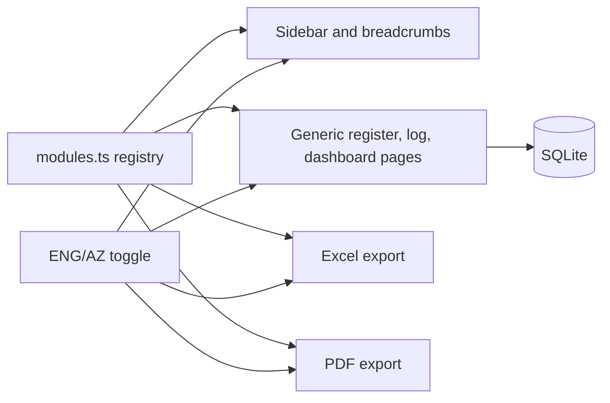
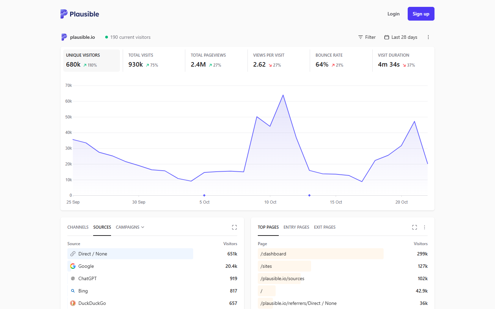
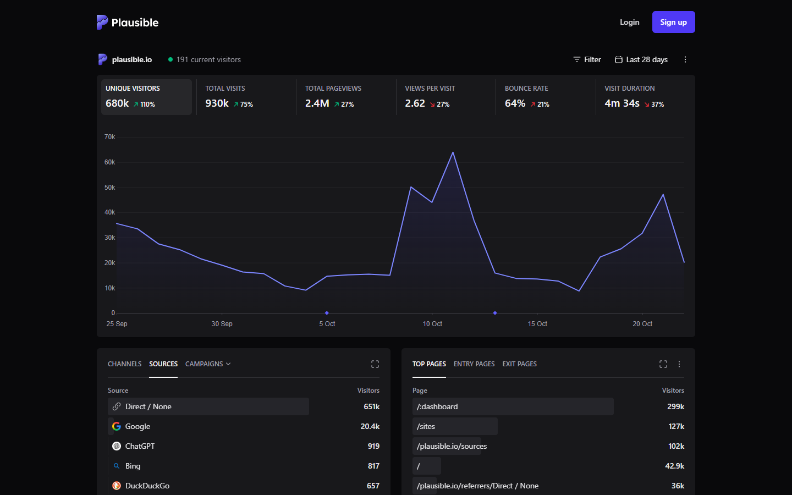
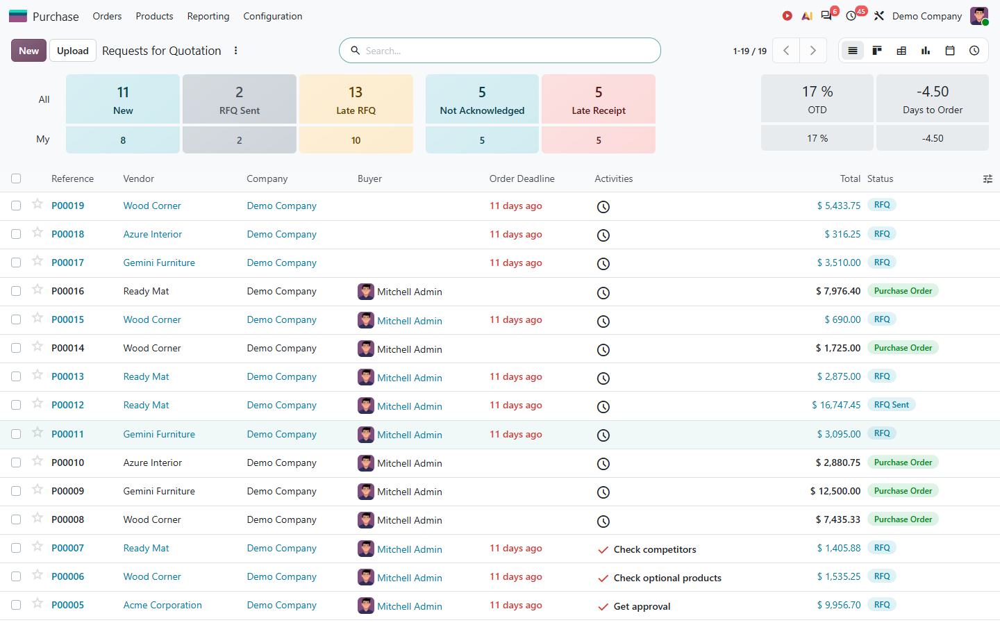
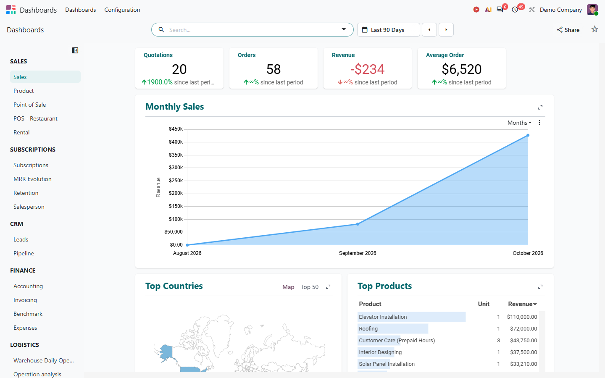
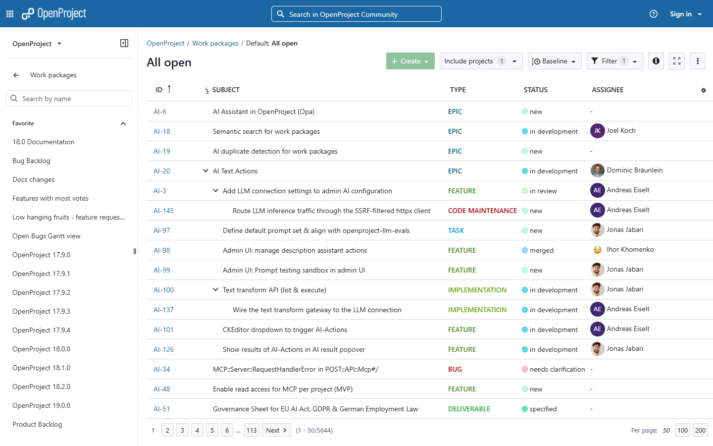

# Bilingual project-management platform skeleton (ENG/AZ)

## Decisions taken
- Product is a **web platform**. Each of the 16 folders becomes a module, each listed workbook tab becomes a page.
- First build is **all 16 modules as bilingual registers and dashboards**. There is no CAD or BOQ processing yet.
- The workspace `d:\AZ-BOQ` has no code, only the Hadrut data and two notes. The app goes in a new folder, `d:\AZ-BOQ\app`. The Hadrut files stay in `d:\AZ-BOQ\data` untouched.

## Proposed stack (assumption, easy to swap)
- Next.js (App Router) with TypeScript and Tailwind
- Language files for AZ and EN, with the toggle in the app header, saved in a cookie so it survives reloads
- Prisma with SQLite for storage (no external database needed to start)
- `exceljs` for Excel export, `@react-pdf/renderer` for PDF export
- An embedded Noto Sans font in the PDF. The default PDF font drops Azerbaijani letters (Ə ə İ ı Ğ ğ Ş ş Ç ç Ö ö Ü ü)
- shadcn/ui as the accessible primitive layer only. Radius, border opacity, input height, focus ring and table header are customised so the app does not look like the shadcn docs (skill, Tier 2)

## Core design: one registry drives everything
A single file, `app/src/config/modules.ts`, holds the 16 modules from your structure. Each module has a code (`00` to `16`), a folder name, a workbook name (`PJ_00_COMMAND_CENTER`), and its ordered tabs. Each tab has:
- a key
- an `az` title and an `en` title (taken directly from your list)
- a type: `dashboard`, `register`, `log`, or `special`
- column definitions (for registers and logs)

Navigation, page titles, tables and exports are all generated from this file. Adding a tab later means one entry, not new code.

## Reference designs and final look: "Quiet Utility"

Earlier sets were rejected: Dreams ERP and Adex looked like generated templates, and GitHub Issues and Pulse are repository pages, not business software. The set now uses screens from real business products only: Plausible Analytics (public demo dashboard), Odoo (real ERP demo session) and OpenProject Community (real project management). Captured at 1440 x 900.

What they share: almost no colour, one surface level, rows with hairline separators instead of stacked cards, small type, tight rows, hierarchy from text weight and size.

**1. Dashboard, light (Plausible).** All KPIs sit in one strip inside a single card: muted label, value, delta. No icons, no boxes. One chart. Below it, plain ranked lists with a faint inline bar behind each row.

**2. Dashboard, dark (Plausible).** Same layout in dark. Surfaces step lighter, borders stay faint, one accent colour. This is the only dark reference found for a real product, so dark tokens still follow the UI/UX skill's elevation rules.

**3. Register list (Odoo, Purchase).** Real ERP register: title, one `New` button, search, then a row of status counts that double as filters (All and My), then a plain table with checkbox, reference, vendor, buyer, deadline, total and status. Take: counts-as-filters and the table structure. Leave: the pastel coloured count tiles, filled status pills, the saturated purple button.

**4. Dashboard with KPI strip (Odoo, Dashboards).** Four figures in a row with deltas, one large chart, then a ranked table with inline bars, a left list of dashboards by area. Take: the structure and the ranked list. Leave: teal headings and the soft blue area fill.

**5. Dense table with hierarchy (OpenProject).** The pattern for BOQ, WBS and work-package style registers: indented parent and child rows, a plain ID column, a coloured text label for type, a small dot plus text for status, avatar and name for the assignee, pagination and page size in the footer.

**Anti-template rules (what removes the generated look)**
- KPIs are one strip in one card with hairline dividers. No icon-in-a-coloured-box tiles, no sparkline per tile.
- No hero banners, photos, gradients, glass or glow anywhere in the app. No greeting line ("Good morning, ...").
- One surface level: page canvas plus at most one card level. Lists are rows with 1 px separators, not stacks of cards.
- Radius: 6 px on controls, 8 px on cards. Nothing larger. No shadows, only 1 px borders.
- Type: 13 px in tables, 14 px body, 20 px page titles. Uppercase only for small column or section labels. Numbers use tabular figures.
- Density: 36 to 40 px table rows, 8 and 12 px gaps. Not 56 px rows with 24 px padding.
- Colour: near-monochrome. One solid accent for the primary button, links and focus ring. Status is a small dot or icon plus text, in fixed green, amber, red, blue. No filled pill badges on every row.
- Sidebar: neutral surface (not a saturated brand colour), 13 px text, the active item shown by a subtle background tint. Groups use plain small labels.
- Icons: 16 px, thin stroke, used in navigation and where they speed recognition. Never in coloured squares.
- Charts: one hue, thin lines, no gradient fills, no 3D, no decorative donuts unless the share is the point.
- Copy: short and literal, for example `12 open actions, 3 overdue`. No marketing lines inside the app.

**Decisions**
- Name: Quiet Utility.
- Accent: one solid cobalt (about `#2457C5`) for the primary button, links and focus. Navy sidebar and amber button from the earlier choice are dropped.
- One solid primary button per view.
- Empty states always say what belongs there and offer `New record`.
- Font: a sober sans plus a mono for IDs and codes. It still has to pass the glyph check for `Ə ə İ ı Ğ ğ Ş ş Ç ç Ö ö Ü ü`.
- Sidebar layout has no strong reference in this set (Plausible has none, OpenProject's looks dated). It follows the rules above and the 6-group navigation plan.
- Module coverage (not the look) was checked against the Dreams ERP construction edition: projects, site reports, inspections, drawings, RFIs, quality, safety, estimates, budgets, cost tracking, inventory, purchase orders, vendors, equipment, invoices. Our 16 modules already cover all of them.
- Screenshots are saved in `app/docs/design-references/` (01 to 05).

## Themes
Light and dark are supported equally from the first build. A theme switch sits next to the ENG/AZ toggle in the header, defaults to the system setting, and is saved with the language preference. Both themes use the same semantic tokens, and every screen is checked in both.

## ENG/AZ toggle
- Header switch with three states: AZ, EN, and AZ + EN (both titles shown, matching how your tab names are written).
- Applies to the sidebar, page titles, column headers, status values, KPI cards, buttons, dates and number formats.
- The export follows the language selected when the user clicks export.
- The switch is instant, with no page reload (language lives in client state, the cookie is only for the next visit), so it responds within one frame.
- `<html lang>` changes to `az` or `en` with the toggle. Without `lang="az"`, CSS uppercase turns `i` into `I` instead of `İ`, which would break every uppercase micro-label.
- AZ + EN doubles the text in every header and tab. Long strings truncate with a tooltip or clamp to two lines, so the layout never breaks. Tab titles in your list such as `Texniki Sorğu Reyestri / Technical Query Register` are the stress test.

## What each page type contains
- **Dashboard** (`01_Panel / Dashboard` in modules 01 to 16): one KPI strip (4 to 6 figures with deltas, in a single card), one chart, a ranked list or recent-entries list, all fed from that module's registers. Clicking a KPI or a row opens the full breakdown in a slide-over panel, so the page stays readable (progressive disclosure).
- **Register**: sortable and filterable table, add and edit form, status column, owner, dates, attachment link. Columns come from the registry.
- **Log** (for example `10_Tender Jurnalı`, `12_Maliyyə Jurnalı`): append-only list with user and timestamp.
- **Special pages**: `06_Təşkilati Diaqram` (org chart), `07_RACI Matrisi` (roles by tasks grid), `08_Layihə Strukturu` (tabs for WBS, CBS, OBS, Cost Code, BOQ Code, Location), `09_Pul Axını` (cash flow table), `10_Mənfəət & Zərər` (profit and loss table).
- **Module 00 Command Center**: the first six tabs are dashboards (Home, Executive, Project Manager, KPI, Project Health, Project Status), and the rest are registers: Master Log, Action, Decision, Audit, Alert and Exception. Each dashboard aggregates data from the other modules.

## UI/UX rules applied (from `ui_ux_skill.md`)

Only the parts that fit a dense, bilingual management dashboard are used. Scroll-reveal animation, glass cards, grain and cursor spotlight are skipped, because the skill itself says to avoid them in productivity dashboards.

**Navigation (Hick's Law, Serial Position, Jakob's Law)**
- 17 modules is too many top-level choices. The sidebar groups them into 6 collapsible sections: Command Center (00) / Setup, Tender, Contract (01 to 03) / Design and Documents (04, 05) / Site Delivery (06 to 11) / Money and Resources (12 to 14) / Close-out and Master Data (15, 16).
- Command Center is first, Master Data is last. Logo top-left goes home, search top, language toggle and export top-right.
- Ctrl/Cmd+K opens a command palette that searches all ~170 tabs in both languages and shows recent pages first (recognition over recall).
- Search is accent-insensitive so a user on an English keyboard can type `e` and find `Ə`, `i` for `İ` and `ı`, `s` for `Ş` (Postel's Law).

**Hierarchy and grouping**
- One solid primary button per view: `New record` on registers. Export and filters are secondary, row actions are ghost.
- Whole table rows and sidebar items are clickable edge to edge, not just the text (Fitts's Law). Minimum 44 px hit areas on touch.
- Labels sit 6 px above their inputs and 20 px above the next field (Proximity). Forms are one column.
- No card inside a card inside a card. Group by spacing first, borders only where needed.

**Data presentation**
- `tabular-nums` on every number, date and amount so columns do not jitter.
- Numbers and dates follow the language: AZ shows `1 234,50` and `23.10.2026`, EN shows `1,234.50`. Inputs accept both (spaces, commas, dots) and clean them silently.
- Long codes and IDs are chunked (`PJ-02-0147`). Registers show the 6 to 8 most-used columns, the rest sit behind a "columns" menu.
- Alerts from `12_Xəbərdarlıq & İstisna` appear inline next to the record or KPI they affect, styled as native content with an action button, never as a coloured top banner (Banner Blindness).

**States and feedback (all 8 on every component)**
- Empty registers show what belongs there and a `New record` button, never a blank table.
- Anything over 400 ms shows a skeleton that matches the real layout. Add and edit update the list immediately (optimistic) and roll back on failure.
- Errors keep the user's input. Forms validate on blur, then on change once an error is showing.
- Deleting shows a toast with Undo. A finished export shows a toast with the file name and an open button (Peak-End).

**Visual identity (anti-vibecoded checks)**
- Light and dark themes with equal priority, through semantic tokens (`--bg-canvas`, `--bg-surface`, `--bg-elevated`, `--text-primary`, `--border-default`, `--status-*`). Dark surfaces step up in lightness for depth, with 1 px semi-transparent borders.
- One neutral base and one restrained accent used only for the primary button, active nav item and unread alerts. No purple-to-blue gradients, no gradient text, no emoji in labels or headings, no `border-l-4` cards, no hover-opacity fade on buttons, no three-icon-box rows.
- Spacing only on the 4 px / 8 px scale. Nested rounded elements use concentric radii (outer = inner + padding).
- Status colours (success, warning, danger) always pair with text or an icon, never colour alone. Body text 4.5:1 contrast, large text and borders 3:1.
- Modals and slide-overs dim the page behind them to about 70%.
- Font: a distinct pair (a sans for UI, a mono for codes and numbers) from the skill's list, such as IBM Plex Sans with IBM Plex Mono, or DM Sans. The pick must pass a glyph check for `Ə ə İ ı Ğ ğ Ş ş Ç ç Ö ö Ü ü` before it is locked, since not every font ships `Ə`. Noto Sans is the fallback and is already used for PDF.
- UI copy is short and specific, for example `12 open actions, 3 overdue`. No buzzwords, no em dashes.

## Export
- Excel: one workbook per module, named as in your tree (`PJ_00_COMMAND_CENTER.xlsx` through `PJ_16_MASTER_DATA.xlsx`).
- **Sheet-name rule.** Excel sheet names are limited to 31 characters and cannot contain `/`. Names like `08_Layihə Strukturu / Project Structure (WBS + CBS + ...)` will not work. Sheets are named by number plus a short title in the chosen language (for example `08_Project Structure`), and the full bilingual title goes in cell A1 of each sheet.
- PDF: any register or dashboard page, with the bilingual title and the Azerbaijani font embedded.

## Left for the next phase
- The drawing-to-BOQ pipeline in your second diagram (CAD processing, quantity takeoff, BOQ parser, reconciliation) plugs into `05_Əsas BOQ`, `06_BOQ Uyğunlaşdırma` in module 02, and `02_Müqavilə BOQ`, `03_BOQ Uzlaşdırma` in module 12. Those tabs are created now as empty registers so nothing has to be restructured later.
- The "what is still needed" list in your first image (KPI definitions, approval authority, rates, inspection forms, coding standards) is input data and rules. They are not blockers for the skeleton, so they are left as empty configuration to fill in.
- Sign-in and roles are not in scope. The skeleton runs as one user.
- Entry of real data and import from existing Excel files are not in scope.

## Done when
- All 16 modules and every listed tab appear in the sidebar and open.
- Switching AZ, EN or AZ + EN changes every label on every page, with no untranslated text left.
- Every module exports to a valid Excel file and every page exports to a PDF that shows all Azerbaijani letters correctly.
- A record added in one register shows up in that module's dashboard counts and in the Command Center.
- Pre-flight check from the skill passes: squint test shows one focal point and one primary button, no spacing off the 4/8 scale, tabular numbers everywhere, and every list has empty, loading and error states.
- AZ + EN mode shows no clipped or overflowing text on the longest tab titles, and uppercase labels show `İ` correctly in AZ.