# How the Hadrut bill check works

This note explains the AZ-BOQ platform in plain English. It covers what the program does, how a number gets onto a bill line, what a person set by hand, and what the program still cannot do.

The job is one building: the Hadrut fire station, order 9335, in Xocavənd. The client bill is `BOQ-Hadrut.xlsx`. The drawings are the Hadrut package. A DWG is the CAD file the draughtsman drew. A PDF is a plot of a sheet, sometimes with a text layer and sometimes only a picture. The program compares the bill with those drawings. It does not invent a missing number.

A bill line is one row of work: a description, a unit, a quantity, a rate, and an amount. There are 2,175 such rows. The engine does not price the work again. It asks whether the quantity on that row is the quantity printed or measured on the drawings.

English on the screen is for reading. The check itself uses the Azerbaijani text. If the English is wrong, the quantity does not change.

---

## 1. What you see

The app is a website. The engine is Python. The screen is React.

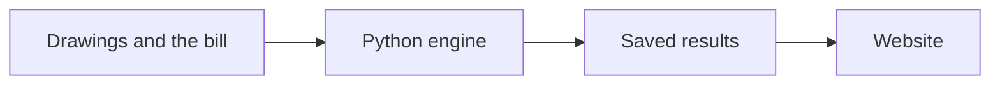

The screens fall into three groups.

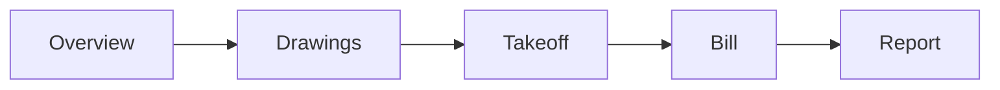

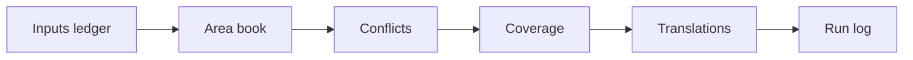

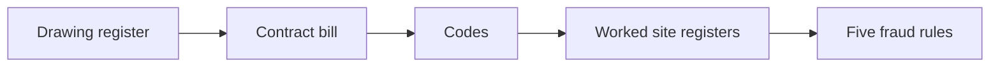

You open the site and click through these screens.

| Screen | What it is for |
|---|---|
| Overview | How many bill lines are backed by a drawing, and the biggest differences |
| Drawings | Every file in the package, then one sheet with the text and room outlines |
| Takeoff | The numbers read or measured from the drawings |
| Bill | Each client line next to the drawing quantity |
| Report | Differences, steel families, and the Excel and PDF files to hand over |
| Inputs ledger | Every number the check uses, and where it came from |
| Area book | Room areas from the schedules, and a hatch area when the plan supports it |
| Conflicts | Places where two documents disagree. Both sides stay |
| Coverage | Which building and trade has drawings |
| Translations | English next to the Azerbaijani. You can correct a translation |
| Run log | Pipeline warnings and the second DWG reader |
| Drawing register, contract bill, codes | Lists taken from this package |
| Materials, measurements, invoices | A worked Hadrut example, not a live site feed. The fraud rules read these rows |
| Fraud & Alerts | Five rules. A hold or an exception is stored with a name and a reason |
| Projects & Upload | A new package is hashed and classified. The takeoff is not rerun from the upload |

The overview is the place to start. It shows how much of the contract value sits on lines that have a drawing behind them, how much sits on the 20 lines that disagree, and how much has no drawing evidence. Clicking a count opens the bill already filtered to that status. The contract total on that screen is the client's own chain: the sum of the lines, then temporary works, contingency, and VAT, ending at the figure in cell C5 of the workbook. The program checks that chain. It does not replace it.

Search (Ctrl+K) jumps to a screen, a bill line, or a measured item.

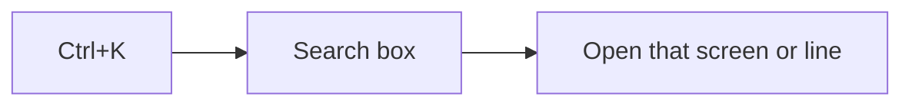

---

## 2. How a run works

Each step saves its result. The website only reads what was saved. It does not measure while you click.

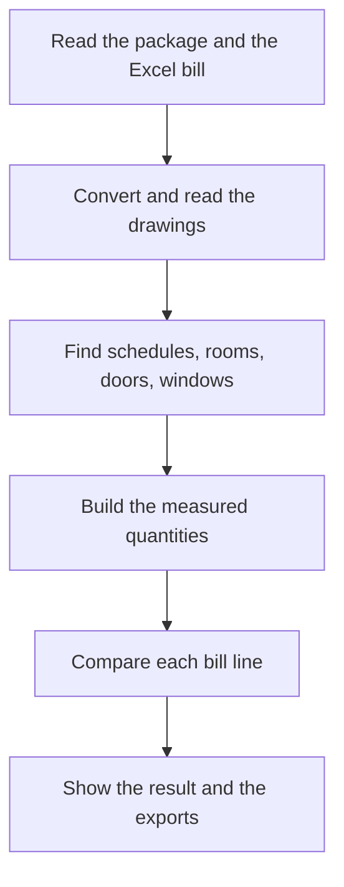

Each step below is one job.

**Ingest.** List every file. Junk is a file that is not a drawing of this job. A scan is a PDF with no text layer, so nothing can be copied out of it automatically. A copy for another order is a sheet numbered 9336 or 9337, or a background of this architecture placed inside an electrical drawing. Those copies are kept in the list so you can see them. They are not treated as a second measurement of the same room.

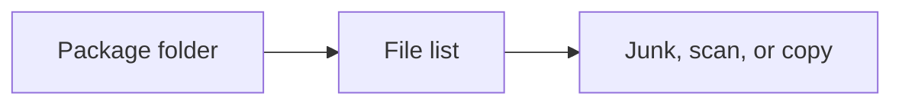

**Bill.** Read the Excel bill: sections, lines, quantities, rates, amounts. A section is a heading such as floors or doors. The line quantity is what the contractor billed. The rate and amount are kept so a gap can be shown in manat as well as in metres. The program does not edit the rate.

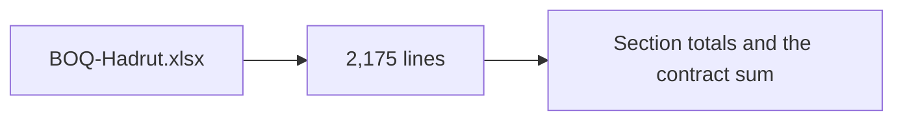

**Conversion.** A DWG cannot be read directly by the checker. ODA turns it into a DXF, which is a text form of the same drawing. LibreDWG then counts the entities again. If the two counts disagree, or if LibreDWG crashes, values taken from that file stay in review. Seven files are in that state. The numbers are still shown. They are not treated as settled.

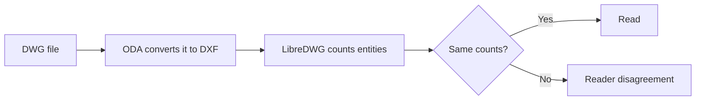

**Read.** Pull text, dimensions, tables, and hatch areas out of each DXF. A dimension is a measured length the draughtsman placed on the plan. A hatch is a filled shape, often the floor finish of one room. Its area is geometry. It is not the same thing as the area printed in the room schedule, and the two are kept separate.

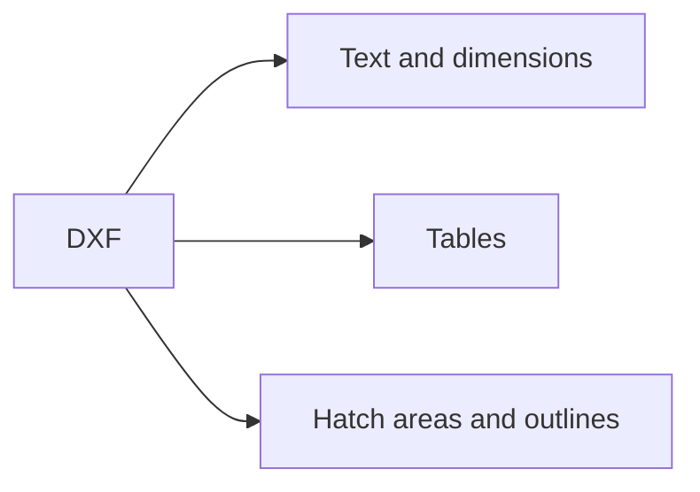

**Sheets.** One DWG often holds many sheets. The checker finds each frame and reads the title block: sheet number, title, and building. "Baş plan" and "planlaşdırma" are site plans. They are not the depot floor plan, so a length taken from them is not used as the length of the building.

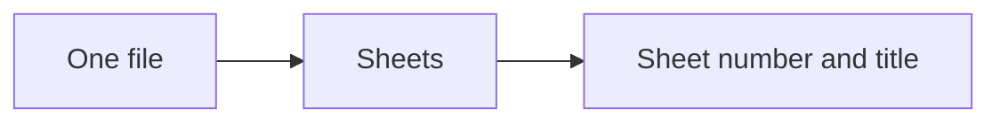

**Schedules.** Read ruled tables.

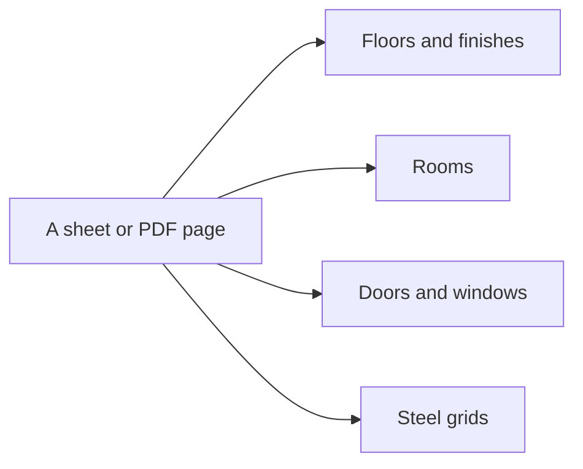

**Index.** Make a list of every number, with the words around it. The words matter. A bare 4 next to a tank note is not evidence that a bill line for four seals was printed. The index keeps the sentence, not only the digits. A level mark such as a floor height written with a plus or minus is not treated as a length.

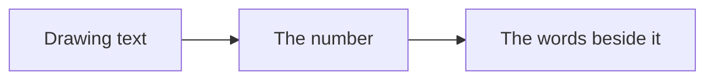

**Source map.** Note which building and trade each file covers.

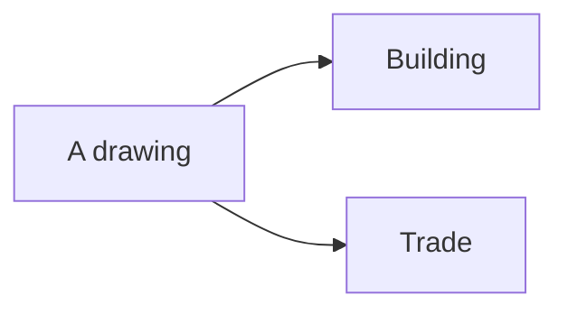

**Vision.** Reads scans only if an OpenAI key is set. It is not set, so scans stay unread.

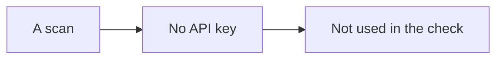

**Takeoff.** Turn drawing evidence into quantities. There are 51 measured items. Most bill lines have no item, because no measuring rule was written for that trade. An item can be verified (a second source agrees), extracted (read once), in review (a person should look), or blocked (a needed input is missing, so there is no number). Two items are blocked: the depot wall length, and the basement stone wall that depends on it.

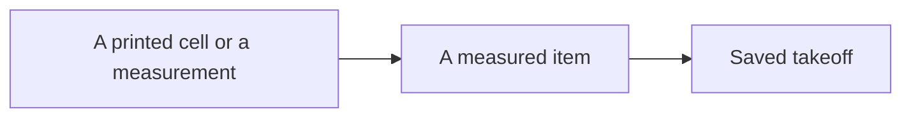

**Reviews.** Apply a person's decision, if one was saved. A decision never measures.

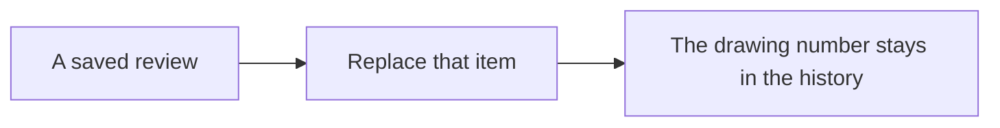

**Match.** Give every bill line one status.

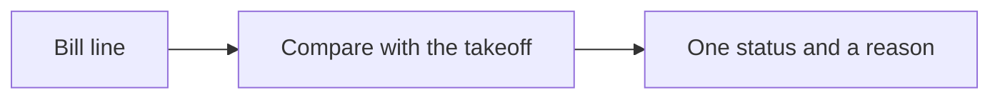

**Floors.** Group lines onto basement, 1st floor, or 2nd floor for the floor bill.

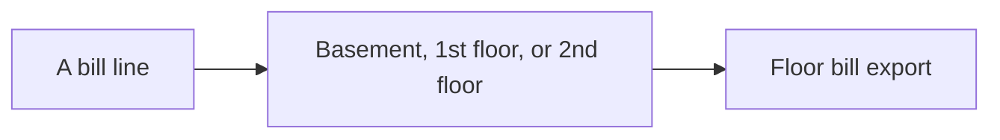

**Operations.** The drawing register, the contract bill, and the codes come from this package. Deliveries, site measures, and invoices are a worked example so the five fraud rules have something to compare.

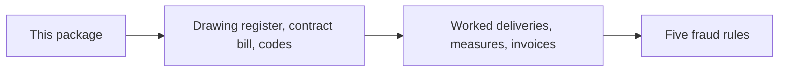

---

## 3. What a number must carry

Every number is a value with a source. If an input is missing, the result has no number. The program does not fill the gap with a guess.

```mermaid
flowchart LR
    printed[A number on a drawing] --> value[A value with its source]
```

```mermaid
flowchart LR
    value[That value] --> line[A bill line]
    line --> status[One status]
```

A value records:

- the number and the unit
- how it was obtained (see the table below)
- whether it is solid, needs a look, or is blocked
- the file, page or sheet, and the text as printed
- the formula, if the number was calculated
- what was searched and what was rejected

| How it was obtained | Plain meaning |
|---|---|
| Read from a schedule | A cell in a table, such as a window width |
| Printed on a drawing | A note such as `L=190.5` or `9 ədəd` |
| Measured from geometry | A length or a hatch area on the plan |
| Calculated from other values | Arithmetic, such as width × height × count |
| Read by vision | A scan, only if that reader has run |
| Project rule | A number a person typed because the file could not be read |
| Set by hand | A review a person saved in the app |

The gap on a line is **bill quantity minus drawing quantity**. A negative gap means the bill is smaller than the drawing. A positive gap means the bill is larger. The overview also multiplies that gap by the line's rate, so you can see the manat as well as the metres. That money figure is illustrative. It is not a new valuation.

---

## 4. How one bill line is checked

First the program looks for a measured item that a person already joined to the line.

```mermaid
flowchart LR
    line[Bill line] --> item[Measured item]
    item --> agree{Same number?}
    agree -->|Yes| matched[Matched]
    agree -->|No| different[Different]
```

If that item has no number, the line is blocked.

```mermaid
flowchart LR
    missing[Item has no number] --> blocked[Blocked]
    blocked --> blank[The line shows no quantity]
```

If nobody joined an item, the program looks for the same quantity printed on a drawing of the same building. A weak hint is a number with no unit, or with too few digits to be trusted on its own. A small count such as 3 or 9 is accepted as "printed" only when it sits in a count column, or when it is written as "9 ədəd" next to the same kind of thing the bill line names. Otherwise it stays a candidate in review, and the line's quantity stays empty.

```mermaid
flowchart LR
    line[Bill line] --> printed{Printed on a drawing of this building?}
    printed -->|A real count or measure| ok[Printed on drawing]
    printed -->|Only a weak hint| review[Needs review]
    printed -->|Nothing| notfound[Not on drawings]
```

**Derived** is separate. The line repeats another checked line, or converts it. An example is tonnes from cubic metres, using a density that is named.

```mermaid
flowchart LR
    parent[A checked line] --> child[A later line in the same build-up]
    child --> derived[Derived]
```

An automatic join is allowed only when three checks pass.

```mermaid
flowchart LR
    item[Measured item] --> billable{Allowed on a bill line?}
    billable -->|Yes| kind{Same kind of work?}
    kind -->|Yes| decimals{Same number at the printed decimals?}
    decimals -->|Yes| matched[Matched]
```

A storey height is not a pipe. A tank slab is not excavation. A whole number on the bill does not equal 3.89 printed to two decimals. Derived numbers are the exception: 252.276 m² of glass is compared with the bill's 252 at the bill's decimals, because those extra decimals came from the arithmetic, not from a cell that printed 252.276.

Current result on this bill, 2,175 lines:

| Status | Lines | Meaning |
|---|---:|---|
| Matched | 47 | The drawing quantity equals the bill at the bill's decimals |
| Printed on drawing | 139 | The quantity is printed on a drawing of that building |
| Derived | 14 | The line follows another checked line |
| Different | 20 | A drawing quantity exists and it is not the bill quantity |
| Needs review | 763 | Only a weak hint, or a factor that is not a measurement |
| Blocked | 1 | The measured item has no number, so the line has no number |
| Not on drawings | 1,191 | Nothing on a drawing of this building supports the line |

"Backed by a drawing" on the overview is matched + printed + derived = **200** lines.

A whole-number bill quantity is not allowed to swallow a nearby decimal. A storey height of 2.7 m is not a 3 m pipe. A tank slab of 3.89 m³ is not 4 m³ of excavation. An automatic link also needs the same kind of thing: glass with glass, not a bay size with a duct.

---

## 5. Worked examples

These are the lines people open first. The numbers are the engine's, with the source named.

**Window glass, line 2.6.7.** The bill says 252 m². The window schedule on `9335 MH.pdf` prints width, height, and count for P-1, P-2, P-3, and P-4. The area is the sum of width × height × count, then divided by 1,000,000 to turn square millimetres into square metres. The result is **252.276 m²**. Status: matched. The join to the bill line was made by hand, so the screen says **Review required · linked by hand**.

```mermaid
flowchart LR
    cells[Width, height, count] --> sum[Add the four marks]
    sum --> area[252.276 square metres]
```

**Roof windows, line 2.5.19.** The drawing prints `Dam pəncərəsi DP-1 (9 əd)`. Status: printed, quantity 9.

```mermaid
flowchart LR
    text["9 ədəd next to DP-1"] --> line[Line 2.5.19]
    line --> printed[Printed, quantity 9]
```

**Gutters and downpipes, lines 2.5.13 and 2.5.14.** The sheet states 154.2 m and the itemised pipes add to 190.5 m. The bill has those two numbers on opposite lines. Status: different. The reason says they were swapped. The program does not swap them back.

```mermaid
flowchart LR
    stated[Stated 154.2 m] --> billA[One bill line]
    parts[Itemised 190.5 m] --> billB[The other bill line]
```

**Garage floor, lines 2.7.12 and 2.7.13.** The bill says 665.3 m². The floor schedule and the PDF room schedule say 658.30 m². The finish schedule and the DWG room text say 665.3. A hatch on `(SON).dwg` measures 659.39 m². Status: review. No side is chosen.

```mermaid
flowchart LR
    floor[Floor schedule 658.30] --> review[Stay in review]
    room[PDF room 658.30] --> review
    hatch[Hatch 659.39] --> review
```

```mermaid
flowchart LR
    finish[Finish schedule 665.3] --> review[Stay in review]
    dwg[DWG text 665.3] --> review
    bill[Bill 665.3] --> review
```

**Plywood sheets, line 2.7.27.** The bill says 100 sheets of 1.52 × 1.52 m. That size is in the bill text, not on the drawing. 230.6 m² ÷ (1.52 × 1.52) is 99.8, rounded up to 100. Status: review, and the screen says the factor came from the bill text.

```mermaid
flowchart LR
    area[230.6 square metres] --> divide[Divide by sheet size from the bill]
    divide --> sheets[100 sheets, in review]
```

**Fire tank walls and bottom, lines 10.1.15 and 11.1.15.** Bottom slab 9.41 m³ plus one wall 4.58 m³ times a count of 4. The 4 is the printed Miq. cell, not an assumption. Result **27.73 m³**. Status: matched.

```mermaid
flowchart LR
    bottom[Bottom 9.41] --> sum[Add]
    wall[One wall 4.58] --> times[Times count 4]
    times --> sum
    sum --> total[27.73 cubic metres]
```

**Drinking tank, lines 12.1.13 and 13.1.13.** Bottom 3.89 m³ plus walls 10.60 m³. The table does not say "for one element", so there is no multiplier. Result **14.49 m³**.

```mermaid
flowchart LR
    bottom[Bottom 3.89] --> add[Add the printed wall volume]
    walls[Walls 10.60] --> add
    add --> total[14.49 cubic metres]
```

**Doors.** Metal, PVC, and MDF door areas are width × height × count from the door schedule. The bill splits doors at 3 m². The program follows those words. Metal doors are Q-1, Q-9, and Q-9*. PVC doors up to 3 m² are Q-2, Q-3, and Q-4, which come to 43.68 m² against the bill's 41.79. MDF doors up to 3 m² include Q-7, so the drawing total is 88.83 m² against the bill's 71.19. MDF over 3 m² is Q-8, 6.72 m² against 15.54. Those differences stay. Q-7 is not dropped to force a match. Q-9 and Q-9* are kept as two different marks.

```mermaid
flowchart LR
    row[One door row] --> area[Width times height times count]
    area --> group[Metal, PVC, or MDF]
```

**Depot wall length.** Hatches on the second-floor plan add up to about 72 m². The room schedule total is 779 m². Hatches are the tiled rooms, not the floor and not the wall. Status: blocked. There is no number.

```mermaid
flowchart LR
    hatches[Hatches about 72 square metres] --> stop[Not the wall]
    rooms[Room schedule 779] --> stop
    stop --> blocked[No wall length]
```

**Joist coverage.** Some lines are 0.8 times a printed floor area. Line 2.7.15 is 0.8 × 129 m² from the 1st floor, type 2, which is 103.2 m² against a bill of 104. Line 2.7.23 is 0.8 times the printed laminate area. That 0.8 is the estimator's factor, not a length on the drawing. Status: review. A nearby ratio that is only roughly 0.8, such as 21 / 26, is not treated as this factor.

```mermaid
flowchart LR
    printed[Printed floor area] --> factor[Times 0.8]
    factor --> review[Review, not a measurement]
```

---

## 6. What was set by a person

Some files under `backend/demo_rules/` tell the engine where to look, or hold a number the drawings could not supply. Calling that "hardcoded" in the website would hide the difference between a measurement and a choice. The website says **Project rule** or **Review required**, and it shows the citation: which file, which bill line, or which note the person used. You can accept the reason. You cannot make the label disappear.

```mermaid
flowchart LR
    rules[A project rule] --> chip[Review required]
```

```mermaid
flowchart LR
    hand[A hand link] --> chip[Review required]
```

```mermaid
flowchart LR
    factor[An estimator factor] --> chip[Review required]
```

### Numbers a person typed because a file could not be read

| Rule | Value | Why it is not from a drawing |
|---|---|---|
| Basement area in the general note | 1,360.2 m² | The general note is a scan. No text layer, and no scan reader has run |
| Soil haul density | 1.75 t/m³ | The estimator's choice. The bill's tonnes equal 8,683 m³ × 1.75 |
| Topsoil haul density | 1.2 t/m³ | Same kind of choice. 626.4 t = 522 m³ × 1.2 |

### Where the engine is told to look

`extractors.yaml` names the file and the words to search for each measured item. The quantity still has to be printed or measured. Examples: the depot long side on the plan, the fire-tank table, the window schedule. These rules do not type the answer. They say where to read it.

```mermaid
flowchart LR
    rule[Where to look] --> drawing[The drawing]
    drawing --> number[The printed number]
```

A few of those items are inputs, not bill lines. The depot is 45.2004 m by 34.6 m. The basement storey is 2.7 m and the upper storey is 3.3 m. The bay module is 6 m. Those numbers are used inside other calculations, or shown on the takeoff so you can see the scale. They are marked not billable, so a bill line that happens to say 3 m or 6 m is not joined to them.

### Links a person made

`bill_map.yaml` joins a measured item to one or more bill lines. There are 38 links, from BM-001 to BM-038. A link is a person's judgement that this measured item is what that bill line is pricing. The quantity still comes from the drawing. The link is only the join. An "equal" link means each of those lines should match the item. A "sum" link means the lines together should match it, which is how the one asphalt area of 599.7 m² is compared with the two bill lines 383.7 and 216 without adding those two lines into one. Examples:

- window glass to line 2.6.7
- fire-tank walls and bottom to lines 10.1.15 and 11.1.15
- asphalt 599.7 m² split across lines 19.1.3 (383.7) and 20.1.3 (216), kept as two lines

Each of these shows **Review required · linked by hand**, with the link id.

```mermaid
flowchart LR
    item[Measured item] --> link[Hand link]
    link --> line[One or more bill lines]
```

### Words that decide what a line is

`bill_elements.yaml` maps Azerbaijani words to a kind of work. `nov` is a gutter. `novalça` is a downpipe. `pəncərə` is a window. The first fitting rule wins. This stops a storey height from matching a pipe just because the numbers are close.

```mermaid
flowchart LR
    words[Words on the bill line] --> kind[Gutter, window, door, or another kind]
    kind --> match[Only the same kind can match]
```

### Other rule files

| File | What it holds |
|---|---|
| `conflicts.yaml` | Known disagreements, with a suggested side: seismic intensity, the 0.000 level, substation voltage, basement area, contract sum. Nothing is averaged |
| `sheet_marks.yaml` | Sheet-number marks that say which building and trade a sheet belongs to |
| `layer_roles.yaml` | 24 layer-name patterns, such as wall, hatch, or text |
| `legacy_font_overrides.yaml` | Four letters in an old font that the automatic match got wrong |

The full table, with citations, is in `HARDCODED.md`. That file is a report. It is not shown in the website.

### Factors that are not measurements

These are calculated in the matcher and labelled on the line:

- **0.8 coverage** on joist lines such as 2.7.15. The screen says this is the estimator's factor.
- **Sheet size taken from the bill text**, such as plywood 1.52 × 1.52 m. The screen says the factor came from the bill text.
- **Densities** between 1.2 and 2.5 t/m³, used only when the bill lines themselves show that ratio.

---

## 7. What the program can do

- Read the client bill and keep its sections, rates, and totals.
- Read DWG files after conversion, and PDF files that have a text layer.
- Decode old CAD fonts and mixed Azerbaijani and Cyrillic letters.
- Find sheets, title blocks, schedules, room lists, door and window tables, and steel tables drawn as text on a grid.
- Measure plan lengths that pass a known check: the depot long side is 45.2004 m and the short side is 34.6 m.
- Store hatch outlines and show them on the depot plan. A room tag inside a hatch can name the room. A hatch much larger than the room schedule is not assigned to that room.
- Compare each bill line and explain the status in a sentence.
- Open the source on the sheet: file, page or region, and the printed text.
- Show the formula with the numbers filled in. Window glass lists P-1 to P-4 with width, height, and count.
- Keep both sides when documents disagree.
- Group steel tables by columns, beams, slabs, belts, stairs, and foundations. Kilograms stay on the mark. They are not added into a bill quantity, because the drawing does not say how many of each mark are built.
- Export a checked workbook, a discrepancy report, a bill generated from the measurements, and a bill split by floor.
- Save a person's review: set a value, set a missing input, accept a reason, or choose a side. The reason and the name are required. The old value stays in the history.

---

## 8. What it cannot do

Wall length is not measured.

```mermaid
flowchart LR
    lines[Parallel wall lines] --> notBuilt[Pairing is not built]
    notBuilt --> blocked[No length]
```

A second check of the fire-tank wall is not measured.

```mermaid
flowchart LR
    schedule[Schedule volume is used] --> missing[No centreline length]
    missing --> unverified[Not verified from geometry]
```

Steel kilograms are not written onto the bill.

```mermaid
flowchart LR
    table[One mark and its kilograms] --> noCount[No plan count]
    noCount --> blocked[Family stays blocked]
```

Scans are not read.

```mermaid
flowchart LR
    scan[Scan with no text] --> noKey[No vision key]
    noKey --> unused[Not used]
```

Site registers are a worked example.

```mermaid
flowchart LR
    package[Drawings and one bill] --> worked[Worked deliveries, measures, invoices]
    worked --> demo[Shown for the fraud rules, not a live site feed]
```

| Gap | Why |
|---|---|
| Depot external wall length | Pairing parallel wall lines is not built. Hatch areas are not used, because they do not match the room schedule |
| Basement limestone wall area | It needs that wall length, so it stays blocked |
| Fire-tank wall checked a second way | The schedule path is done (4.58 m³ × 4). A centreline × height × 0.25 m check was not measured, so the line is not marked verified from geometry |
| Steel kilograms as bill tonnes | The tables name marks such as S-6. The bill does not. Without a plan count, the family stays blocked |
| Roof area and wall area from hatches | Hatches are per tiled room, not the whole floor. They are shown per room in the area book. They are not used as the floor or the wall quantity |
| Scans | Seven scans have no text layer. The vision reader has not run, because no API key is set. Tesseract is not installed |
| Most of the bill | 1,191 lines have no drawing evidence in this package. Many trades were never given a measuring rule |
| Materials, measurements, invoices | Not in the client package. The screens use a worked example so the fraud rules can be shown. They are not live site records |
| Uploaded packages | A new package is stored and classified. It does not run the takeoff by itself |
| English for every string | Many Azerbaijani strings have no English until a translation key is set. The check does not need that English |
| A full drawing workspace | You can open a sheet, see outlines, and keep a few tabs. There is no separate Sources / Calculation / History inspector, and you cannot draw a new polygon on the sheet to measure it |
| Floor build-up in the area book | The area book shows the room schedule and a hatch. It does not list every finish layer for the room |

Reader disagreements: 7 DWG files differ between the two readers. Values taken from those files stay in review.

The checked Excel can be a few pages longer than the client's file, because this Excel wraps long descriptions differently. The cells and styles are the client's. Room-schedule totals also disagree with the sum of the rooms on two floors: the basement rooms add to 11 m² more than the printed Cəmi, and the 1st floor rooms add to 2.9 m² less than the printed Cəmi. The 2nd floor adds up exactly. Those gaps are shown. They are not corrected.

---

## 9. Reviews

A person can accept a "review required" reason, or choose one side of a conflict. The app asks for a name and a reason. The chip then says **Reviewed by** that person. It does not disappear.

```mermaid
flowchart LR
    person[Name and reason] --> save[Saved review]
```

```mermaid
flowchart LR
    save[Saved review] --> check[Bill check runs again]
    check --> chip[Reviewed by that person]
```

```mermaid
flowchart LR
    reset[Reset] --> keep[Old row stays]
    keep --> engine[Engine number comes back]
```

The engine value stays visible. A reset does not delete the old row. It adds a new row that puts the engine value back.

---

## 10. Each remaining screen

**Open a drawing.** The file list leads to one sheet. Each row shows the sheet number, the title, the building, and how the file was read. Copies of other orders stay behind a count, with a button to show them. At most six sheet tabs stay visible. Opening another sheet from the list adds a tab. The rest sit in a small overflow list. A PDF page is shown from its text layer. A DWG sheet is a picture rendered from the converted file, with the text the checker read listed beside it.

```mermaid
flowchart LR
    list[File list] --> sheet[One sheet]
    sheet --> tabs[A few tabs]
```

**Text on the sheet.** Click a word in the list and the marker moves to that spot.

```mermaid
flowchart LR
    word[A word in the list] --> marker[Marker on the sheet]
```

**Room outlines.** A hatch is drawn on the plan. A room number inside it can name the room. If the hatch is much larger than that room's schedule area, it is not assigned.

```mermaid
flowchart LR
    hatch[Hatch outline] --> tag[Room number inside it]
    tag --> name[Room name]
```

```mermaid
flowchart LR
    tooBig[Hatch much larger than the room] --> skip[Not assigned to that room]
```

**Area book.** One row per room: the schedule area, a hatch when there is one, and the bill lines that mention that room. Under a floor, the rooms are also compared with the printed Cəmi. The garage row is the one to show a client: schedule 658.3 m², hatch 659.39 m², and links to bill lines 2.7.12 and 2.7.13. The book does not average those with the finish schedule's 665.3.

```mermaid
flowchart LR
    room[Room schedule] --> row[One row]
    hatch[Hatch, if it fits] --> row
    row --> lines[Bill lines]
```

**Bill drawer.** Click a line. The drawer shows the bill number, the drawing number, the reason, and, when the quantity was calculated, the formula with each input named. For window glass that is P-1 through P-4, each with width, height, count, file, and page. A source card opens that spot on the sheet. If the only hits are weak, the cards are labelled as candidates, not as accepted evidence. The page number you see is one higher than the number stored in the file, because the file counts the first page as 0. The window schedule is stored as page 21 and shown as page 22.

```mermaid
flowchart LR
    click[Click a line] --> reason[Reason]
    click --> formula[Formula with numbers filled in]
    click --> source[File and page]
```

**Conflicts screen.** Takeoff disagreements and drawing disagreements are listed. Both sides stay.

```mermaid
flowchart LR
    takeoff[Takeoff disagreements] --> page[Conflicts screen]
    drawings[Garage, downpipes, room totals] --> page
```

**Coverage.** A cell is one building and one trade. Click it to see the sheets.

```mermaid
flowchart LR
    cell[Building and trade] --> sheets[The sheets for that cell]
```

**Inputs ledger.** Filter by how the number was obtained. A project rule shows its citation.

```mermaid
flowchart LR
    all[Every input] --> filter[Schedule, geometry, or project rule]
```

**Translations.** English sits beside the Azerbaijani. A correction is saved. The check still uses the Azerbaijani.

```mermaid
flowchart LR
    az[Azerbaijani] --> en[English, for reading]
    en --> fix[You can correct the English]
```

**Report and exports.** The difference list matches the bill filter. Steel families are listed and blocked. The files download.

```mermaid
flowchart LR
    report[Report] --> files[Checked bill, discrepancy report, generated bill, floor bill]
```

**Steel families.** Tables are grouped by the words in the mark. Kilograms stay on that mark.

```mermaid
flowchart LR
    mark[Sütun, tir, örtük, and the others] --> group[One family]
    group --> blocked[Blocked until a plan count exists]
```

---

## 11. Controls and smaller rules

These are real parts of the platform. A sentence is enough for each one.

**Language.** The header switches descriptions between English, Azerbaijani, or both. Hover still shows the original Azerbaijani when the screen is in English. The check never uses the English.

**Theme and menu.** Light and dark are a preference. The side menu can float, or stay pinned.

**Bill list.** Chips filter by status. A building menu and a search box narrow the list. Search folds Azerbaijani letters, so `nezaret` finds `Nəzarət`. Arrow keys move the open line. Escape closes it. Enter on a highlighted row opens it. Previous and next sit on the drawer.

**Accepting a reason.** On a bill line, a review-required chip can be accepted. The form asks for your name and why. The chip then reads "Reviewed by" that name and stays visible.

**Choosing a garage side.** The area book has a Decide box on the garage conflict. You type a number that is already printed in the reason, plus your name and why. The line stays in review. The program will not accept a new number that was not already printed.

**Takeoff list.** Chips filter by verified, extracted, review, or blocked. The gate mark passes when the depot long side is 45.2004 m and the short side is 34.6 m. Those two lengths are the check that the plan scale is right. Clicking an input name opens its source on the sheet when the source can be shown.

**Sheet viewer.** The wheel zooms. Dragging pans. Fit shows the whole sheet. "Back to the evidence" recentres on the mark that was opened from a bill line or a takeoff item. Clicking a coloured room outline shows its label and area in the side panel.

**Report tabs.** Different, backed by a drawing, needs review, blocked, not on drawings, and measured with no bill line. The last tab is for inputs such as the gate length and the storey height. They were measured, and they are not themselves a bill line.

**The four export files.** The checked bill keeps the client's layout and fills drawing quantities where the line is different and backed by an item. The discrepancy report lists the gaps. The generated bill is built from the measurements. The floor bill splits lines into basement, 1st floor, and 2nd floor. A unit the program does not recognise is left as printed, with a note that it is not a measured unit.

**Run log.** Filter by warning, or by stage: read, conversion, schedules, takeoff, match, and the others. The reader table shows ODA and LibreDWG entity counts side by side.

**Codes.** Each section code opens the bill already filtered to that code.

**Commands, outside the website.** `run` walks the pipeline. `convert` turns DWG into DXF. `libredwg-check` is the second reader. `fonts` builds tables from fonts embedded in PDFs. `hardcoded-report` rewrites `HARDCODED.md` from the rule files. `tiles` draws the sheet pictures in advance. `export` writes the Excel and PDF files. `translate` fills English only when a key is set. `serve` starts the website.

**What a review can do.** Set a new number on an item. Fill one missing input and recalculate the formula. Link a line to an item. Accept or reject. Choose a printed side of a conflict. Reset, which puts the engine number back and keeps the old row.

**Reading rules that are easy to miss.** Old CAD fonts are decoded letter by letter. Four letters that the automatic match got wrong are fixed in a small table. Mixed Azerbaijani and Cyrillic, such as a Cyrillic letter inside an Azerbaijani word, is folded before matching. A dimension is kept when it is on a plan. A facade, a section, or a site "baş plan" is not used as the depot length. Inside one build-up, a later line can supply the quantity for an earlier line of the same area, and the other way around. A stated size written in the bill description explains the line. It does not become the measured quantity. A polystyrene volume is the schedule area times a thickness printed on that floor type.

---

## 12. Where the pieces live

| Piece | Place |
|---|---|
| Engine | `backend/azboq/` |
| Rule files | `backend/demo_rules/` |
| Tests | `backend/tests/` |
| Website | `frontend/src/` |
| Saved results and exports | `cache/` |
| Client files | `data/` (not in git) |
| List of person-set values | `HARDCODED.md` |

The client package is not in the git repository. The derived cache is. That cache is the saved reading of the drawings: text, schedules, hatch outlines, the bill check, and the export files. Anyone with the repository can open the website and see the check without the original DWG folder. Regenerating the check still needs that folder, which stays on the machine that holds `data/`.
