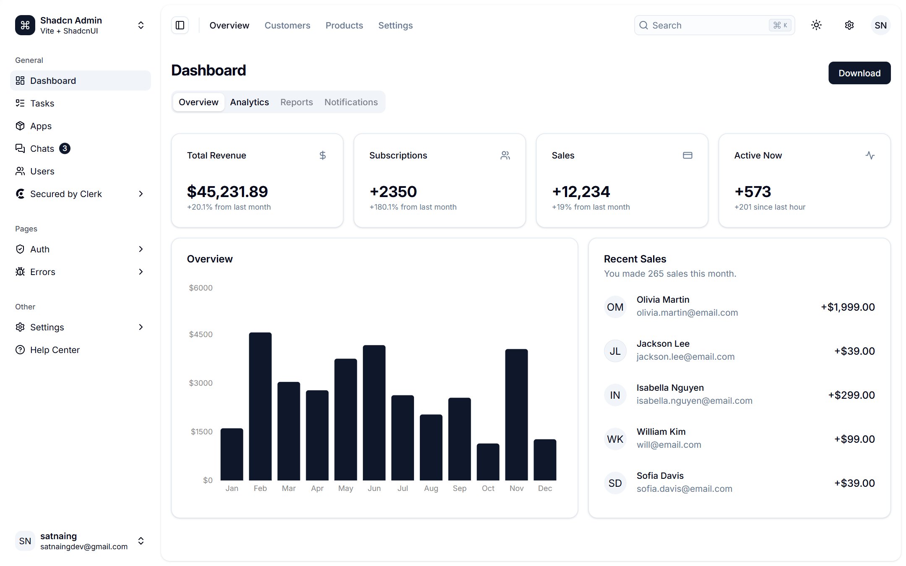
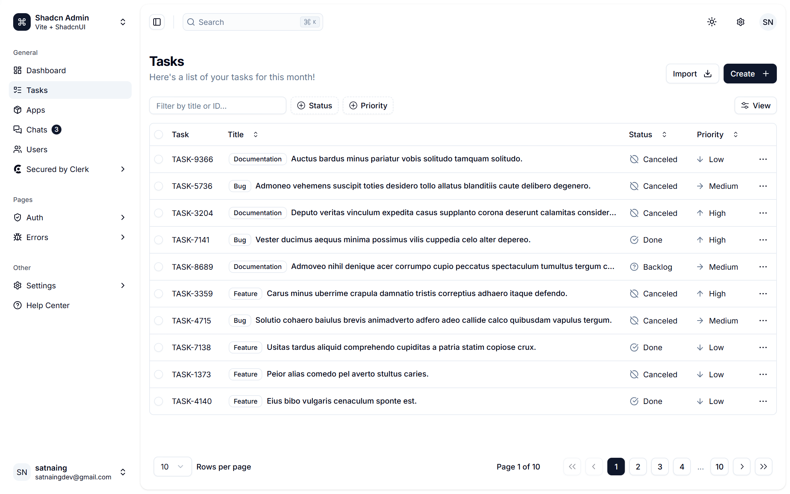
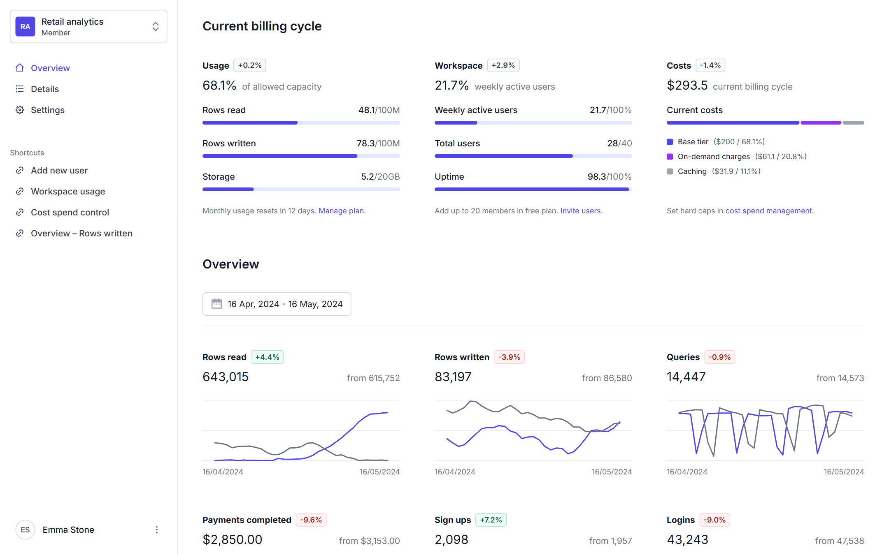
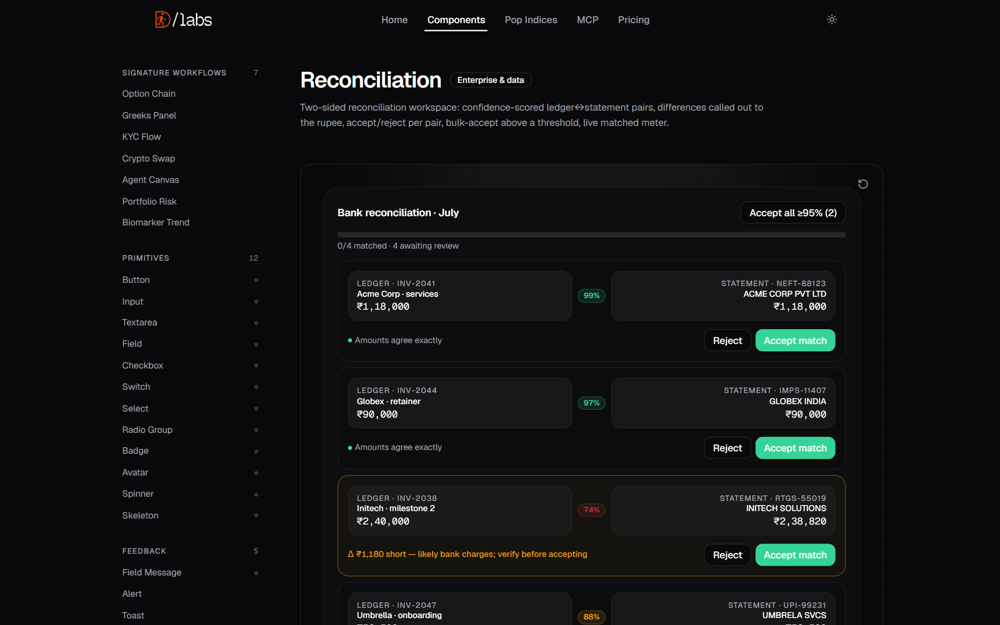
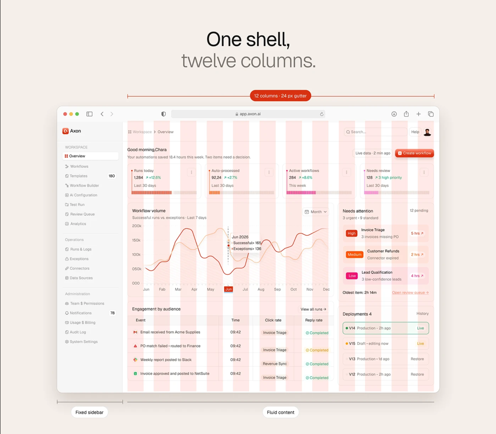
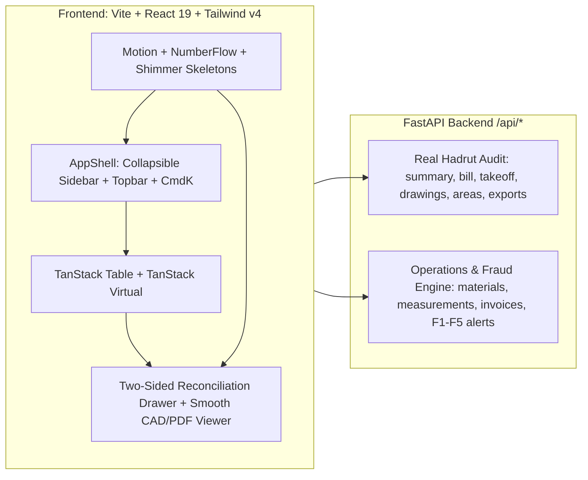

# AZ-Takeoff: Light-First UI/UX Redesign & Operations Mock Data Plan

## 1. Executive Summary & Diagnosis of Current UI

The backend verification engine (`backend/azboq/`) already performs real CAD/PDF extraction and BOQ validation on Hadrut Order 9335, but the current frontend (`frontend/`) undermines the product:

1. **No component architecture or styling system:** `frontend/src/styles.css` is ~600 lines of custom CSS with loud `#ff6a00` orange gradients (`--accent-fill`), dated shadows, and raw HTML `<table>` tags hard-capped at 500–600 rows (`Bill.tsx`, `Report.tsx`, `Operations.tsx`).
2. **Awkward navigation:** `App.tsx` uses a custom hover-flyout icon dock (`Dock`) with delayed timers instead of a clean, predictable enterprise sidebar.
3. **Jarring loading & state transitions:** Every page renders a bare `
 Loading…` spinner (`ui.tsx`), and saving a quantity override or conflict decision triggers `window.location.reload()` (`Bill.tsx:94`, `Areas.tsx:61`), destroying scroll context and feeling broken.
4. **Dead Operations & Fraud screens:** `backend/azboq/operations.py` leaves `materials`, `measurements`, and `invoices` as empty `[]` arrays with `runnable: False` on all fraud rules (`F1–F3`), making half the sidebar look unfinished during demos.

### Core Goal
Rebuild the frontend into a **crisp, light-first, modern B2B audit & operations workspace** (combining `shadcn-admin` structure, `Tremor` financial/coverage bars, and `DUKU` two-sided reconciliation cards) with **layout-matched shimmer skeletons, spring micro-interactions, 60fps virtualized tables**, and **live cross-linked Hadrut mock data for Operations & Fraud Intelligence** — while keeping all Hadrut Drawing-to-BOQ verification results 100% real and intact.

---

## 2. Visual Direction & Reference Architecture

All captured reference screenshots live in `docs/design-samples/` and define specific surfaces of the redesigned platform:

### 2.1 Shell, Sidebar & Dense Data Registers — `shadcn-admin` (Light-First)
Used for the application frame, collapsible left navigation, `Ctrl+K` command bar, and register tables (`Operations`, `Inputs Ledger`, `Translations`, `Report`).

### 2.2 Executive KPIs & Financial Breakdown Bars — `Tremor`
Used on `Overview`, `Report`, and `Coverage` to show backed vs. contradicted vs. unbacked AZN contract value using clean horizontal segmented bars and comparative building charts instead of heavy orange rings.

### 2.3 Two-Sided BOQ ↔ Drawing Reconciliation — `DUKU` (Adapted to Light Mode)
Used inside the `Bill` inspector drawer, `Conflicts`, and `Fraud Intelligence` alerts: pairs **Client Bill / Invoice** on the left against **Drawing Evidence / Site Measurement** on the right with exact variance pills (`Δ` and `%`), formula audit trail, and inline approve/override actions.

### 2.4 Human-in-the-Loop Triage & Audit Queue — `Axon`
Used for the prioritized **"Needs Attention"** queue on `Overview` and the 4-stage horizontal verification pipeline tracker.

---

## 3. Design System Tokens & UX Guardrails

### 3.1 Light-First Color Architecture
The platform defaults to **Light Mode** (`#FAFAFA` canvas, crisp `#FFFFFF` elevated surfaces, zero heavy dark chrome). A subtle secondary dark theme remains available in the header toggle, but every screen is designed light-first.

| Semantic Token | Light Mode Value | Usage |
|---|---|---|
| `--bg-canvas` | `#FAFAFA` (`zinc-50`) | App background behind cards and tables |
| `--bg-surface` | `#FFFFFF` | Cards, table containers, sidebar, sticky headers |
| `--bg-subtle` | `#F4F4F5` (`zinc-100`) | Filter pills, table header tint, hover rows, skeleton base |
| `--border-default` | `#E4E4E7` (`zinc-200`) | `1px` crisp card, table, and divider hairlines |
| `--border-hover` | `#D4D4D8` (`zinc-300`) | Interactive card & input hover border |
| `--text-primary` | `#09090B` (`zinc-950`) | Headings, primary figures, active labels |
| `--text-secondary` | `#52525B` (`zinc-600`) | Body copy, secondary descriptions, Azerbaijani/English sub-lines |
| `--text-muted` | `#71717A` (`zinc-500`) | Micro-labels, timestamps, disabled hints |
| `--accent-primary` | `#18181B` (`zinc-900`) | Single primary CTA per view (`Save override`, `Export package`) |
| `--accent-interactive` | `#2563EB` (`blue-600`) | Links, active focus rings, selected row indicator, CAD bbox highlight |
| `--status-ok` | `#059669` / `#ECFDF5` / `#A7F3D0` | `Matches`, `Printed`, `Verified`, `Passed` |
| `--status-info` | `#2563EB` / `#EFF6FF` / `#BFDBFE` | `Derived`, `Extracted` |
| `--status-warn` | `#D97706` / `#FFFBEB` / `#FDE68A` | `Needs review`, `Reader doubt`, `Medium risk` |
| `--status-bad` | `#E11D48` / `#FFF1F2` / `#FECDD3` | `Contradicts drawing`, `Blocked`, `Fraud violation` |

### 3.2 Typography & Azerbaijani Script Rules
- **UI Font:** `Geist Variable` with `Noto Sans` fallback (`frontend/public/fonts/NotoSans-Variable.ttf`) so Azerbaijani glyphs (`Ə ə İ ı Ğ ğ Ş ş Ç ç Ö ö Ü ü`) never fall back to ransom-note system glyphs.
- **Data & Code Font:** `Geist Mono Variable` with mandatory `font-variant-numeric: tabular-nums` (`tabular-nums`) on every quantity, AZN amount, BOQ code, variance percentage, and badge counter.
- **Locale-safe casing:** Keep `lang="az"` on Azerbaijani strings so CSS casing preserves `i ↔ İ` and `ı ↔ I`.
- **Hierarchy:** `22px` (`-0.02em`, `600`) page titles, `14px` (`500`) card titles, `13px` (`400`) dense table rows, `11px` (`0.04em` uppercase, `500`) column micro-headers.

### 3.3 Strict UX & Anti-"Vibecode" Rules Applied
- **One Primary CTA per screen:** High-contrast solid `#18181B` button reserved for the primary screen action; secondary actions use `outline` (`#FFFFFF` + `#E4E4E7` border) or `ghost`.
- **Strict `4px / 8px` spacing & Concentric Radii:** Cards use `rounded-xl` (`12px`) with `p-1.5`/`p-4`; nested buttons/inputs use `rounded-lg` (`8px`).
- **Proximity in forms:** `<label>` sits `6px` (`gap-1.5`) above its `<input>`, with `16px–20px` (`space-y-4`) between fields. Never hide labels inside placeholders.
- **No AI clichés:** Zero purple-to-blue gradients, zero `#ff6a00` gradient buttons, zero `border-l-4` callout stripes on metric cards, zero emojis in headings or navigation.

---

## 4. Frontend Stack & Architecture Upgrade

`frontend/` stays on **Vite + React 19 + TypeScript** (zero framework rewrite needed) and adds focused, lightweight packages:

### Packages to Install in `frontend/package.json`
- `tailwindcss` + `@tailwindcss/vite` (Tailwind CSS v4)
- `motion` (60fps spring drawers, shared `layoutId` segmented tabs, row transitions)
- `@number-flow/react` (smooth rolling tabular numbers when filtering buildings or resolving items)
- `@tanstack/react-table` + `@tanstack/react-virtual` (virtualized 2,175-row BOQ & contract registers with zero lag and no 500-row truncation)
- `cmdk` (fast `Ctrl+K` / `Cmd+K` global command palette with Azerbaijani dot-insensitive matching)
- `sonner` (clean light-mode toast notifications for overrides, decisions, and exports)
- `clsx` + `tailwind-merge` (`cn()` utility for clean primitive styling)

---

## 5. Loading, Motion & Micro-Interaction Specification

1. **Geometry-Matched Shimmer Skeletons (`frontend/src/components/Skeletons.tsx`):**
   - Replace `
 Loading…` across all pages with dedicated shimmer layouts:
     - `OverviewSkeleton`: 4 KPI cards + segmented bar + 4-step pipeline + 2-column bottom grid.
     - `TableWorkspaceSkeleton`: Filter toolbar + 14 shimmer table rows with exact column widths.
     - `SplitTakeoffSkeleton`: Left item list + center blueprint canvas shimmer + right formula tree shimmer.
   - Subtle neutral shimmer gradient (`#F4F4F5 → #ECECEF → #F4F4F5` at `1.4s` infinite) that respects `prefers-reduced-motion`.
2. **Zero Full-Page Reloads (`frontend/src/api.ts`):**
   - Upgrade `useData` with stale-while-revalidate (`revalidate(prefix)`) so submitting a quantity override in `Bill.tsx` or deciding an area conflict in `Areas.tsx` keeps existing data on screen, shows a subtle pending state on the button, updates counts smoothly via `@number-flow/react`, and triggers a `sonner` toast with **Undo**.
3. **Spring-Physics UI Transitions (`motion`):**
   - **Segmented Pills (`EN | AZ | Both`, Status filter tabs):** Shared `layoutId` white pill (`shadow-xs border border-zinc-200/80`) glides smoothly between tabs (`stiffness: 420, damping: 34`).
   - **Slide-Over Reconciliation Inspector:** Opens from the right (`x: 24 → 0`, `opacity: 0 → 1`, `220ms`) with keyboard `Esc` close and `↑ / ↓` or `J / K` next/previous line stepping.
   - **CAD/PDF Viewer Smooth Fly-To (`Viewer.tsx`):** Clicking any `SourceCard` or room polygon smoothly interpolates `{ s, x, y }` over `280ms` (`cubic-bezier(0.22, 1, 0.36, 1)`) onto the target bounding box with a subtle pulsing target reticle.

---

## 6. Screen-by-Screen Redesign Blueprint

### 6.1 Global Shell (`frontend/src/components/AppShell.tsx`)
- **Left Sidebar (`248px` expanded, `60px` collapsed, persisted in `localStorage`):**
  - Clean `#FFFFFF` or `#FAFAFA` surface separated by `1px solid #E4E4E7`.
  - Project switcher header: **Hadrut Fire Depot · Order 9335** (`Active Audit` emerald dot).
  - **4 clear groups** (full-row hit targets per Fitts's Law):
    1. **Overview** — `Command Summary`
    2. **BOQ Verification** — `Drawings` (`61`), `Takeoff` (`51`), `Bill Reconciliation` (`2,175`), `Discrepancy Report` (`20` rose badge)
    3. **Audit Evidence** — `Inputs Ledger`, `Area Book`, `Conflicts` (`5` amber badge), `Coverage Matrix`, `Translations`, `Pipeline Log`
    4. **Operations & Fraud** — `Fraud & Alerts` (live count badge), `Drawing Register`, `Contract BOQ`, `Material Receiving`, `Site Measurements (Forma 2)`, `Invoices (e-Qaimə)`, `Master Codes`
  - Pinned footer card: **Contract Verification Meter** (`29.2%` value backed · `908.3K / 3.11M AZN`).
- **Top Header (`52px` sticky):**
  - Sidebar collapse toggle + clean breadcrumbs (`Hadrut / BOQ Verification / Bill Reconciliation`).
  - Centered/right `Search bill, drawings, or jump…` trigger button with `Ctrl K` keycap.
  - Segmented `EN | AZ | Both` language pill + subtle theme toggle + `Exports` button.

### 6.2 Command Overview (`frontend/src/pages/Home.tsx`)
- **Top KPI Row (4 clean cards):**
  1. *Contract Sum Verified* — `3,811,193.36 AZN` (`Reproduced to 0.00 AZN` emerald pill).
  2. *Drawing-Backed Value* — `908,306.66 AZN` (`29.2%` of line sum · `200` lines).
  3. *Contradicts Drawings* — `20 lines` (rose text + AZN exposure + direct `Review discrepancies →` link).
  4. *Operations Fraud Flags* — `5 active flags` (from the live Operations & Fraud module, linking straight to `Fraud & Alerts`).
- **Tremor Segmented Value Bar Card:** Full-width stacked horizontal bar showing exact AZN and line count share across *Matches*, *Printed on Drawing*, *Derived*, *Contradicts*, *Needs Review*, and *No Drawing Evidence* — clicking any legend pill filters the Bill view.
- **4-Stage Connected Verification Pipeline:** Horizontal connected step track (`01 Drawings Read` → `02 Takeoff Gate` → `03 Bill Reconciliation` → `04 Handover Exports`) with continuous `2px` progress connectors.
- **2-Column Bottom Grid:**
  - *Left (7 cols):* **Value & Verification Coverage by Building** — crisp horizontal progress bars per Hadrut building (`4-Bay Fire Depot`, `Retaining Wall & Fence`, `Drill Tower`, `Vertical Grading`, `Heating Point`, etc.).
  - *Right (5 cols):* **Needs Attention Queue** — tabbed between *Drawing Contradictions & Conflicts* and *Operations Fraud Alerts*, styled as clean actionable rows.

### 6.3 BOQ Reconciliation Workspace (`frontend/src/pages/Bill.tsx`)
- **Top Filter Bar:** Segmented status tabs (`All 2,175`, `Contradicts 20`, `Needs Review 764`, `Backed 200`, `Unbacked 1,191`), Building dropdown, Trade dropdown, and instant Azerbaijani/English search.
- **Virtualized Master Grid (`@tanstack/react-virtual`):**
  - Renders all **2,175 lines** smoothly at 60fps with sticky section group headers (`2.5 — 4-bay Fire Station (Roof covering)`).
  - Columns: `Code`, `Description (EN/AZ/Both)`, `Unit`, `Bill Qty`, `Drawing Qty`, `Variance (Δ)`, `Amount (AZN)`, `Status`.
- **Two-Sided Reconciliation Drawer / Split Pane (Right):**
  - Opens smoothly when a row is selected.
  - **Side-by-Side Comparison Header (`DUKU` pattern):** Left box (`CLIENT BILL: 154.2 m`) ↔ Right box (`DRAWING EVIDENCE: 190.5 m`, `+23.5%` rose badge).
  - **Embedded Sheet Preview (`Viewer.tsx`):** Shows the exact PDF page or DWG sheet region with smooth zoom-to-marker.
  - **Formula & Source Trail:** Expandable inputs, schedule row citations, and translation hover.
  - **Inline Override Form:** Single-column form (*Quantity / Expression*, *Reviewer Name*, *Audit Reason*) with blur validation, optimistic save, and toast + Undo.

### 6.4 Drawings & Sheet Studio (`frontend/src/pages/Drawings.tsx` + `Viewer.tsx`)
- Toggle between **Card Grid** and **Compact Register Table** grouped by discipline.
- Inside a drawing file (`DrawingDetail`): 3-pane CAD/PDF studio — collapsible left *Sheet List*, center high-contrast blueprint canvas with floating pill HUD (`-`, `100%`, `+`, `Fit`, `Jump to pin`), and right *Extracted Sheet Text & Room Polygons* list.

### 6.5 Takeoff, Area Book, Conflicts, Coverage & Report
- **`Takeoff.tsx`:** 3-pane layout with prominent **Depot Geometry Gate** banner (`45.2m × 34.6m · 6.0m bay · 2.7m / 3.3m storeys — All 5 Checks Passed`), clean status chips, interactive sheet viewer, and visual dependency tree for formulas.
- **`Conflicts.tsx` & `Areas.tsx`:** Side-by-side comparison cards (*Document A* vs *Document B*) with one-click *"Select this figure"* radio cards instead of forcing users to re-type numbers into plain text inputs.
- **`Report.tsx`:** Executive summary strip + tabbed discrepancy tables + dedicated **Handover Package Drawer/Grid** (`BOQ-Hadrut-checked.xlsx/.pdf`, `Hadrut-discrepancy-report.xlsx/.pdf`, `BOQ-Hadrut-generated.xlsx/.pdf`) with format badges, file sizes, and Excel formula verification checkmarks.

---

## 7. Operations & Fraud Intelligence Mock Data Plan

To make Module 2 (**Construction Operations & Fraud Intelligence**) complete and realistic without polluting the real Hadrut drawing-verification numbers:

1. **Keep Module 1 100% real:** `/api/summary`, `/api/bill`, `/api/takeoff`, `/api/report`, `/api/areas`, and `/api/register` remain purely driven by the real Hadrut files.
2. **Seed Realistic Hadrut Order 9335 Operational Records in `backend/azboq/operations.py` (or `backend/demo_rules/mock_operations.yaml`):**
   - Every mock row will carry `"source": "mock_demo"` metadata (displayed with a subtle `Simulated Site Data` badge in the Operations header so evaluators know site execution data is simulated on top of Hadrut's real contract BOQ).
   - **`materials` (`PJ_08` Material Receiving — ~28 realistic rows):** Deliveries from Azerbaijani suppliers (*Baku Steel Company*, *Norm Sement*, *Holcim Qaradağ*, *Azərboru*, *STP Polimer*) tied to real Hadrut BOQ lines (`2.2.5` A-3 rebar, `2.3.10` B25 slab concrete, `2.5.9` 0.4mm profnastil roofing, `10.1.15` fire-tank B25 concrete, `21.1.3` crushed stone road base, `25.2` sawn M50 limestone).
   - **`measurements` (`PJ_12` Forma-2 Site Measurements — ~24 realistic rows):** Certified monthly site progress quantities (`Forma-2 Akt №01–№03`) across Depot Foundations, Frame, Roof, Fire Tanks, Retaining Wall, and Vertical Grading.
   - **`invoices` (`PJ_13` Contractor Invoices / e-Qaimə — ~18 realistic rows):** Submitted subcontractor & supplier invoices (`EQ-2026-0412`, etc.) with quantities, unit rates, AZN totals, approval status, and linked BOQ/PO codes.
3. **Evaluate 5 Live Runnable Fraud & Process Violation Rules (`runnable: True`):**
   - **`F1` — Delivered Quantity Exceeds Contract BOQ (`High`):** e.g., `2,340 m²` of 0.4mm Profnastil delivered against `1,992.0 m²` contract BOQ on Depot Roof (`+348 m²` / `+17.5%` unapproved excess).
   - **`F2` — Invoice Exceeds Certified Forma-2 Measurement (`Critical`):** Subcontractor billed `740.0 m³` on line `2.3.10` (Depot flat slabs) while certified Forma-2 measurement is `676.97 m³` (`+63.03 m³` / `+14,812 AZN` overbilling).
   - **`F3` — Duplicate Delivery Note / Double Billing (`Critical`):** Same weighbridge ticket & truck (`90-JX-482`, `18.40 ton` A-3 rebar) booked under two separate receiving acts 3 days apart (`+22,081 AZN` duplicate exposure).
   - **`F4` — Unit Rate Billed Above Contract Rate (`Medium`):** M50 sawn limestone invoiced at `68.50 AZN/m²` vs. contract rate `59.996 AZN/m²` on Retaining Wall & Fence.
   - **`F5` — Abnormal Material Waste vs. Installed Forma-2 (`Medium`):** B25 ready-mix concrete issued to Fire Water Tanks exceeds certified pour volume by `14.8%` (norm allowance `2.0%`).
4. **Dedicated `Fraud & Alerts` View (`#/ops/fraud`):**
   - Top exposure KPI strip (*Total Flagged Exposure in AZN*, *Critical Violations*, *Open Investigations*, *Registers Monitored*).
   - Two-sided anomaly cards showing **Billed / Delivered** vs. **Contract BOQ / Certified Forma-2**, exact AZN variance, rule triggered, and deep links to both underlying register rows.

---

## 8. Phased Implementation Sequence

1. **Phase 1 — Foundation & Design System (`frontend/`):**
   - Install Tailwind CSS v4, `motion`, `@number-flow/react`, `@tanstack/react-table`, `@tanstack/react-virtual`, `cmdk`, `sonner`, `clsx`, `tailwind-merge`.
   - Set up light-first CSS tokens, typography (`Geist` + `Geist Mono` + `Noto Sans` Azerbaijani), base primitives (`Button`, `Badge`, `Card`, `SegmentedTabs`, `SlideOver`, `Skeleton`, `DataTable`), and SWR cache revalidation in `frontend/src/api.ts`.
2. **Phase 2 — App Shell, Collapsible Sidebar & Command Palette:**
   - Replace `Dock` in `App.tsx` with `AppShell` (collapsible grouped sidebar, sticky top header, `Ctrl+K` `cmdk` modal, smooth `EN / AZ / Both` segmented control).
3. **Phase 3 — Core Screens Overhaul (`Overview`, `Bill`, `Report`):**
   - Rebuild `Home.tsx` with KPI cards, `@number-flow/react`, Tremor segmented AZN bar, connected 4-step pipeline, building coverage bars, and unified triage queue.
   - Rebuild `Bill.tsx` with virtualized 2,175-row `TanStack Table`, sticky section headers, and the spring-animated Two-Sided Reconciliation & Sheet Inspector (eliminating `window.location.reload()`).
   - Rebuild `Report.tsx` with value KPIs, discrepancy filters, and handover export cards.
4. **Phase 4 — Drawings Studio, Takeoff & Evidence Screens:**
   - Upgrade `Viewer.tsx` with smooth `requestAnimationFrame` fly-to zoom/pan and clean floating canvas controls.
   - Restyle `Drawings.tsx`, `Takeoff.tsx`, `Areas.tsx`, and `Evidence.tsx` (`Inputs`, `Conflicts`, `Coverage`, `Translations`, `RunLog`) with matching skeletons and two-sided conflict cards.
5. **Phase 5 — Operations Mock Data & Fraud Intelligence Engine:**
   - Add realistic Hadrut Order 9335 mock deliveries, Forma-2 measurements, e-Qaimə invoices, and live `F1–F5` rule evaluation in `backend/azboq/operations.py`.
   - Build the upgraded `Operations.tsx` registers + dedicated `Fraud & Alerts` workspace.
6. **Phase 6 — Verification & Quality Gate:**
   - Run `pytest` in `backend/` to verify zero regression on real Hadrut takeoff & BOQ tests.
   - Run `npm run build` (`tsc -b && vite build`) and `npm run lint` in `frontend/`.
   - Visually inspect every route in a live browser (`Overview`, `Bill` 2,175-row scroll & drawer, `Drawings` pan/zoom, `Takeoff`, `Conflicts`, `Operations`, `Fraud & Alerts`, `EN / AZ / Both` toggle) and verify zero console/layout issues.
