# How to use the Hadrut drawing check

This guide is for a person who opens the program and needs to check a quantity, see where it came from, or change a bill line. The pictures were taken from the live Hadrut check, order 9335.

English on the screen is for reading. The Azerbaijani text is what the check actually uses. Hover any translated line to see the original.

## 1. Open the program

The address in a browser is the running site. On this machine that is `http://localhost:5173/`. The top of every page is the same.

From left to right:

1. The menu button opens the list of screens.
2. AZ Takeoff returns to the overview.
3. The breadcrumb shows where you are. Hadrut is the project.
4. The search box, or Ctrl K, opens a list. It finds a screen, a measured item, or a bill line. Choosing a row opens that screen.
5. EN, AZ, and Both choose the language of descriptions. EN is English only. AZ is the original only. Both shows the original and the English under it.
6. The moon or sun switches light and dark.
7. Exports jumps to the files you can download.

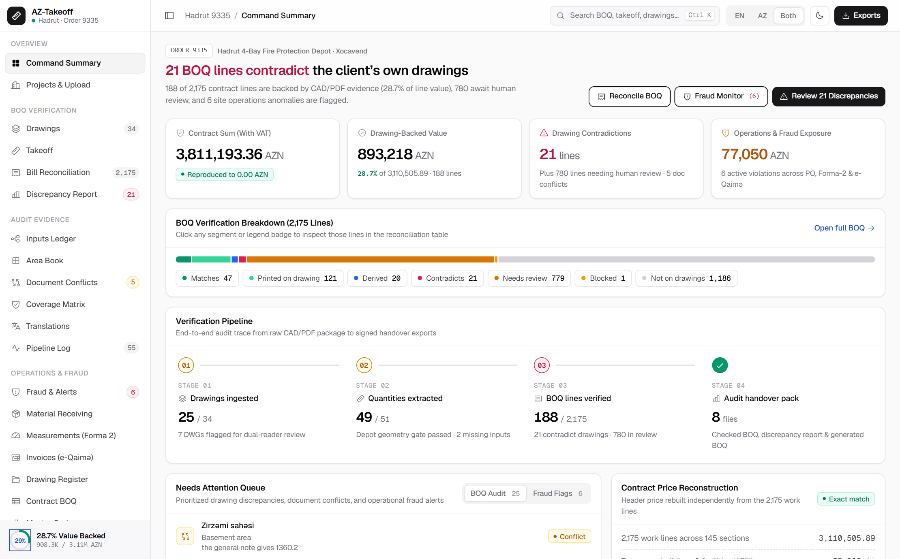

## 2. The sidebar and workspaces

On a wide screen the collapsible left sidebar stays visible (`Ctrl+B` collapses or expands it to an icon rail). On a narrow window, use the menu button at the top left instead. The sidebar has four groups:

1. **Overview:** `Command Summary` and `Projects & Upload`.
2. **BOQ Verification:** `Drawings`, `Takeoff`, `Bill Reconciliation`, and `Discrepancy Report`.
3. **Audit Evidence:** `Inputs Ledger`, `Area Book`, `Document Conflicts`, `Coverage Matrix`, `Translations`, and `Pipeline Log`.
4. **Operations & Fraud:** `Fraud & Alerts`, `Material Receiving`, `Measurements (Forma 2)`, `Invoices (e-Qaimə)`, `Drawing Register`, `Contract BOQ`, and `Master Codes`.

Badges highlight counts that require attention (`Discrepancy Report`, `Document Conflicts`, and `Fraud & Alerts`).

### Projects & Upload

Open **Projects & Upload** from the sidebar to inspect active workspaces or ingest a new client package (`.dwg`, `.dxf`, `.pdf`, `.xlsx` BOQs, or `.zip` archives). Uploaded packages are hashed with SHA-256, AutoCAD versions and vector vs. raster PDF pages are classified automatically, and `.bak` / `.log` junk files are filtered out.

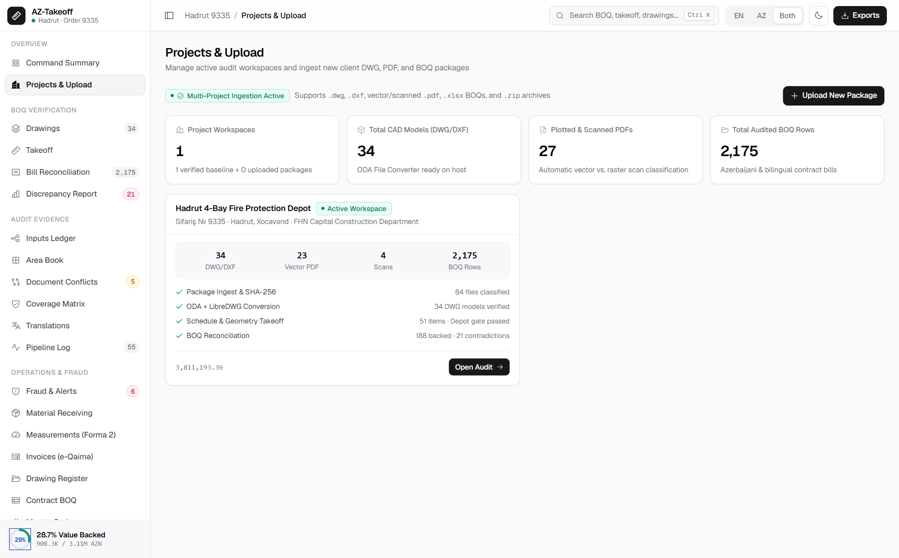

## 3. Overview

The first page says how far the client bill is backed by its own drawings.

The heading counts lines that contradict the drawings. Under it, three buttons open the next place you usually go: Open the differences, Walk the bill, and Exports.

The ring is the share of bill money that sits on lines a drawing confirms. On this check that is 29 percent, which is 908,306.66 of 3,110,505.89.

How the check runs has four steps. Each step is a link.

1. Drawings read. 25 of 34 drawing files were read. 7 DWG files have a reader doubt, so values taken from them stay in review.
2. Quantities measured. 49 of 51 measured items have a number. The depot gate passes. 2 items are blocked because an input is missing.
3. Bill lines backed. 200 of 2,175 lines are backed by a drawing. 20 are different. 764 need a person.
4. Report and exports. 8 files are ready to hand over.

Further down, the coloured bar and the buttons under it split every bill line by result. Click a colour or a name to open only those lines. The meanings are in the next section.

Needs attention lists contradictions, blocked measurements, and disagreements. Each row opens the line or the measured item.

The contract card rebuilds the bill header from the lines. On this check it says Reproduced to the cent. That means the work lines, the 1.8 percent for temporary buildings, the 2 percent contingency, and the 18 percent VAT add back to the header price of 3,811,193.36.

Where the line value sits shows each building. The orange part of the bar is money on lines a drawing confirms. Click a building to open its bill lines.

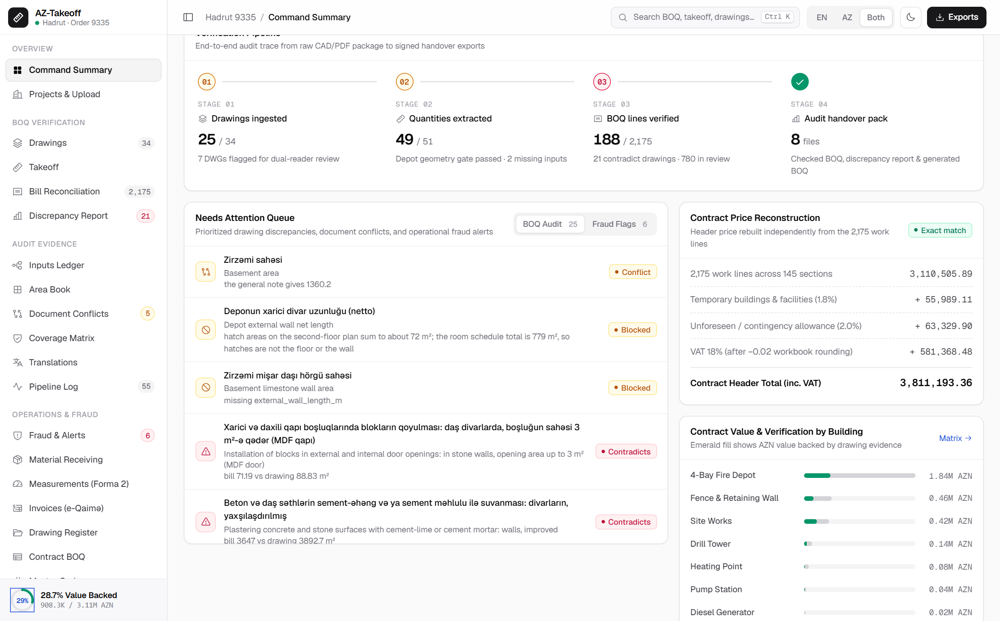

## 4. What each result means

Every bill line gets one of these results. You will see the same words on the overview, the bill, and the report.

Matches. The drawings give the same quantity as the bill.

Printed on drawing. The same number is written on a drawing of this building.

Derived. The line repeats another checked line, or it is the same quantity, or it is converted from one, for example tonnes from cubic metres.

Different. The drawings give another quantity. These are the contradictions.

Needs review. The check found only a weak candidate. A person has to look.

Blocked. A measurement needs an input that is missing. Nothing is guessed in its place.

Not on drawings. There is no measured item, and the quantity is not printed on any drawing of this building.

A result is not a silent average. If two documents disagree, both numbers are kept and the line stays in review or in conflicts until a person decides.

## 5. Drawings

Open Drawings from the menu.

The five cards at the top are the package count: 61 files, 34 DWG files, 23 PDF drawings, 4 scans, and 7 reader disagreements. A reader disagreement means two programs that read the DWG do not agree. Values taken from those files go to review. They are not treated as settled.

The chips under the cards filter the list: All, DWG, PDF, Scans, and Reader disagreement. The search box finds a file name, a building, or a sheet title.

Each card is one file. It shows the kind (PDF, DWG, or Scan), how it was read, the file name, how many sheets were found, and the building. Click a card to open that file.

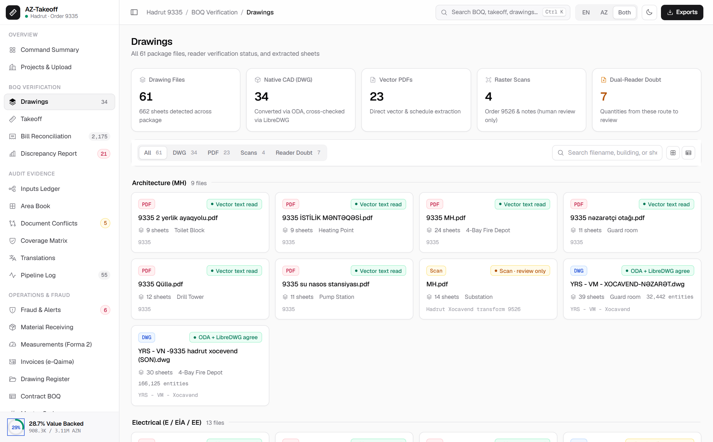

### One file

The left side, or the top on a narrow window, is the sheet list. Each row is one page or one sheet title, with the building and the trade. Click a row to show that sheet.

The picture is the sheet itself. Plus and minus zoom. The mouse wheel zooms. The square shows the whole sheet. You can drag the picture. The crosshair, when it is shown, jumps back to the marked text.

Under the picture, or beside it, is the text the check was able to read. The search under that list finds a word on this sheet. Azerbaijani search ignores dots on letters. Click a line of that text to mark it on the sheet. If you have not clicked a line, the sheet is visible and nothing is marked.

About this file records the kind, the building, and the folder the file came from.

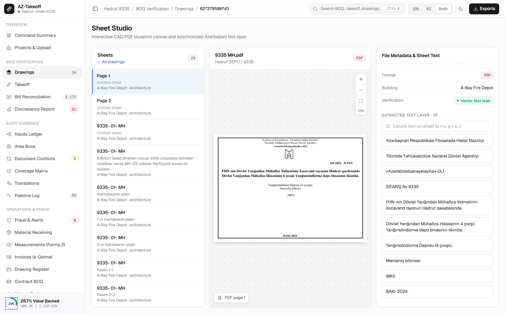

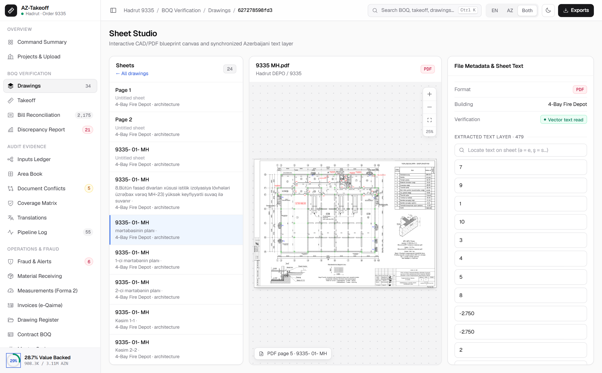

A scan has no text layer. It is shown, and anything that depends on it stays in review. It is not treated as a measured number.

## 6. Takeoff: where a measurement comes from

Open Takeoff. This is the list of quantities the program measured or read, before they are compared with the bill.

The green Gate passes badge means the known depot answers were hit: the long side 45.2 m, the short side 34.6 m, the bay module 6 m, the basement storey 2.7 m, and the upper storey 3.3 m. If that badge fails, do not trust the geometry until you open the failing item.

The chips filter the 51 items: All, Verified, Extracted, Review, and Blocked. Search finds an item, a building, or an element.

Each row shows the name, the number and unit, the building, how it was obtained, and a status.

Verified means the number was checked against a known answer or a second reading.

Extracted means it was read or calculated, and it is usable, but it is not one of the gate answers.

Review means a person should look. The basement area is an example: the schedules do not all print the same area.

Blocked means a required input is missing, so there is no number.

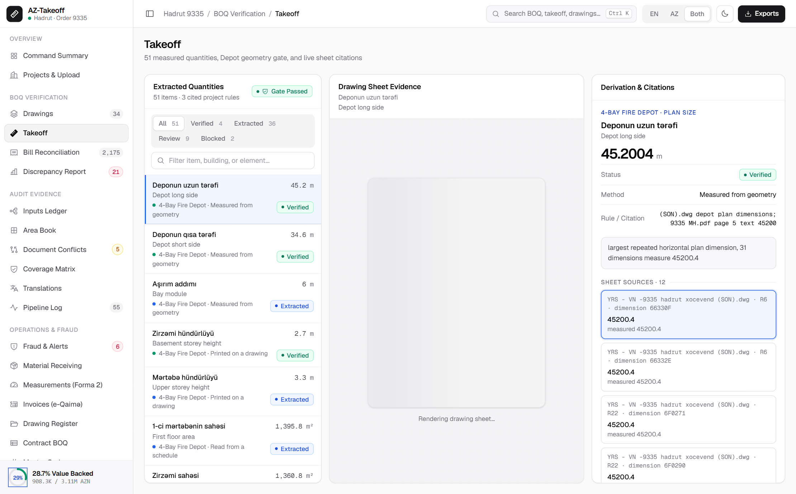

### How to check one measurement

Click the row. The panel titled Why this number opens.

Read these lines in order.

1. The big number is the quantity the check will use.
2. Status tells you whether it is verified, extracted, in review, or blocked.
3. Method tells you how the number was made. The methods are: Measured from geometry, Printed on a drawing, Read from a schedule, Calculated from other values, Project rule, and Read from a scan.
4. Rule is the sentence that says which drawing instruction was followed. Read it. It is the reason the formula looks the way it does.
5. Formula is the sum. For the fire tank walls and bottom it is `bottom_m3 + wall_m3 × count`.
6. Inputs are the pieces of that sum. Each input has its own number, its own status, and the file, sheet, and text it was read from.

Click an input source. The sheet opens with that text marked. That is how you verify a dimension: you are looking at the same words the program read, on the same sheet. Until you click one, the sheet area stays empty and says: Pick something with a source to see it on its sheet.

The first picture is that click. The orange ring is on `9.41 m³`, the bottom of the fire tank, on sheet `9335 - 3,3a - DK`. The second picture is the formula and the source list before a sheet is opened.

On the fire tank, the bottom is 9.41 cubic metres from the schedule text `9.41 m³` on `9335 Xocevend yangin su anbari dk.dwg`, sheet `9335 - 3,3a - DK`. The count is 4, from the Miq. column on the Monolit divar row. The wall element is 4.58 cubic metres. The program does not assume the count. If the count cell is missing, the item is blocked instead of guessing 4.

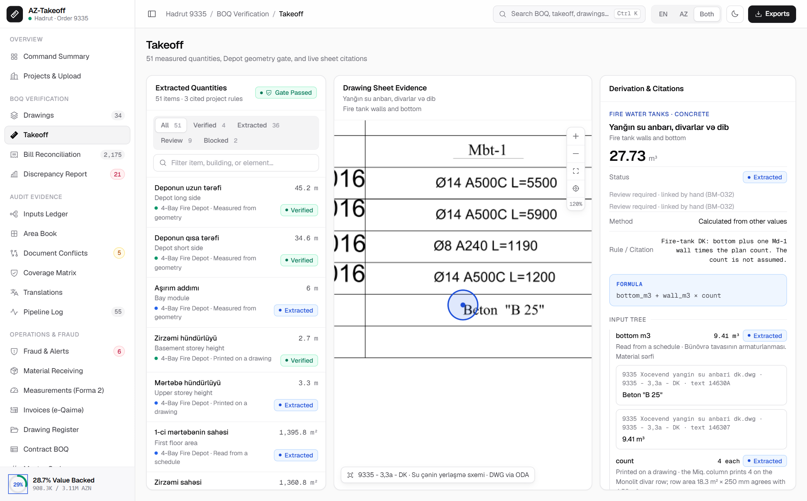

A project rule is a number a person typed into the rules because it was read from a scan or from the client documents, with a citation. It is shaded and it is never shown as if the program measured it.

You do not edit a measured item by typing over it on this screen. If the bill should use a different figure, edit the bill line. Section 8 explains that. The measured item stays as the engine calculated it, so you can always come back and see the original.

## 7. The bill

Open Bill. This is the client bill, line by line, against the drawings.

The chips across the top are the same results as section 4, with a count on each. All is 2,175 lines. Different is the 20 contradictions. Backed by a drawing is the 200 lines that match, are printed, or are derived. Needs review, Blocked, and Not on drawings are the rest.

The building menu limits the list to one building. The search box finds a code or words. Azerbaijani search ignores dots on letters, so ə and e match, and ı and i match.

The table columns are Code, Description, Unit, Bill qty, From drawings, Amount, and Check. Click a row to open it. Up and down arrows move between visible lines. Escape closes the line.

A star on a section code means the code stored in the workbook was repaired from its position. Hover the star to see the stored code.

A reviewer note pill means the client workbook has a comment on that line. Open the line to read the comment in Azerbaijani.

### How to read one line

The panel has two cards.

Bill says is the client quantity, the rate, and the amount. Drawings say is the quantity the check got, and the result.

Under that, the reason explains the gap in words. For line 2.5.13 the drawing gives 154.2 m to the downpipes and the bill gives that number to the gutters, while the gutters on the drawing are 190.5 m. The gap and the money before mark ups are shown when there is a gap.

Where it is printed lists the sheet and the exact text. Click a source to show it on the drawing. That is the check: if the text on the sheet is not the thing the bill line describes, do not treat the number as proof.

If the heading says Weak candidates, not accepted, those cards are only suggestions. They are not proof.

The sheet area under the panel is empty in two cases, and the words tell you which.

Not on drawings says: No drawing of this building prints or measures this line, so there is no sheet to show. Line 2.2.14 is that case. The reason is that no measured item exists and the quantity is not printed on a drawing of this building. The sheet area is blank.

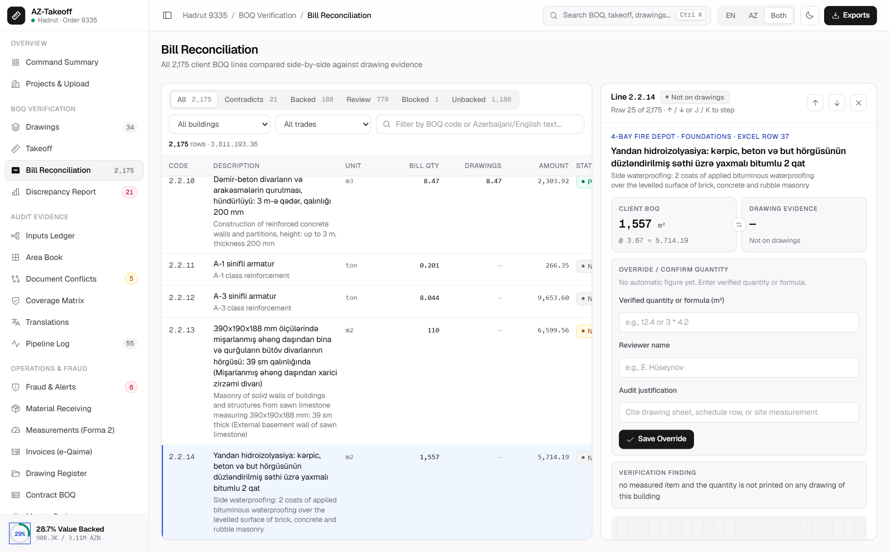

Any other line with nothing to open says: This line has no source to show on a sheet.

A derived line also names the line it follows. That link opens the parent line.

How it is calculated, when present, shows the measured item, the formula, and the formula with the numbers filled in. Dimensions and counts used lists each input and the file, page, row, and column.

### How to edit a quantity

You can set a quantity on a line that is Different, Needs review, or Not on drawings. A line that already matches does not offer the editor. The engine figure is kept. Your figure is what the bill uses until you put the measured figure back.

The form is titled Set the quantity.

1. Read the sentence above the box. It tells you what the check measured, or that the check has no figure yet.
2. Type a number, or a short sum. Examples that work: `190.5`, `12.4`, `3 × 4.2`, `3 x 4.2`, and `10,5`. Use a dot or a comma for the decimal. A word that is not a sum is rejected and the line is left as it was.
3. Type your name.
4. Type why this figure is right. A reason is required. The program will not save a blank reason.
5. Click Save quantity.

After it saves, the drawings column shows your figure, the result is worked out again, and the row is marked edited. If your figure agrees with the bill at the bill's own decimals, the line becomes a match. If it does not, the line stays Different. The old reason is kept under your sentence, so you can still see what the check said.

To undo it, open the line, click Use the measured figure, and give your name. The engine quantity comes back and the edited mark goes away.

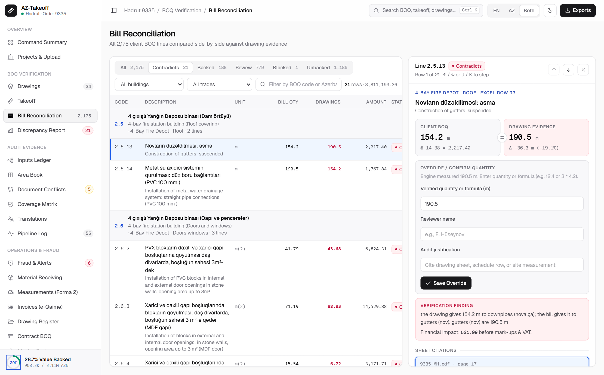

Arrow keys do not change the line while you are typing in a box.

Accept a review reason is a different action. Some lines carry a review flag, such as linked by hand. Accept records that you have seen that flag. It does not change the quantity. Use Set the quantity when the number itself should change.

## 8. Report and the files to hand over

Open Report, or click Exports.

The four money cards are the bill value on lines that are backed, different, waiting for a person, or not on a drawing. Click a card to list those lines.

Steel, by family lists columns, beams, and slabs. Each table names one mark and gives kilograms for that mark. A count of how many of each mark are on the plan is not applied, so the kilograms are not added into a bill quantity. The orange codes open those bill lines.

The chips under the steel list the same groups as the bill, plus Measured, no bill line. That last group is quantities the drawings produced that no bill line uses.

Each difference row shows the code, the description, the bill quantity, the drawing quantity in red when it differs, the money, and the reason. Click the row to open the line on the bill.

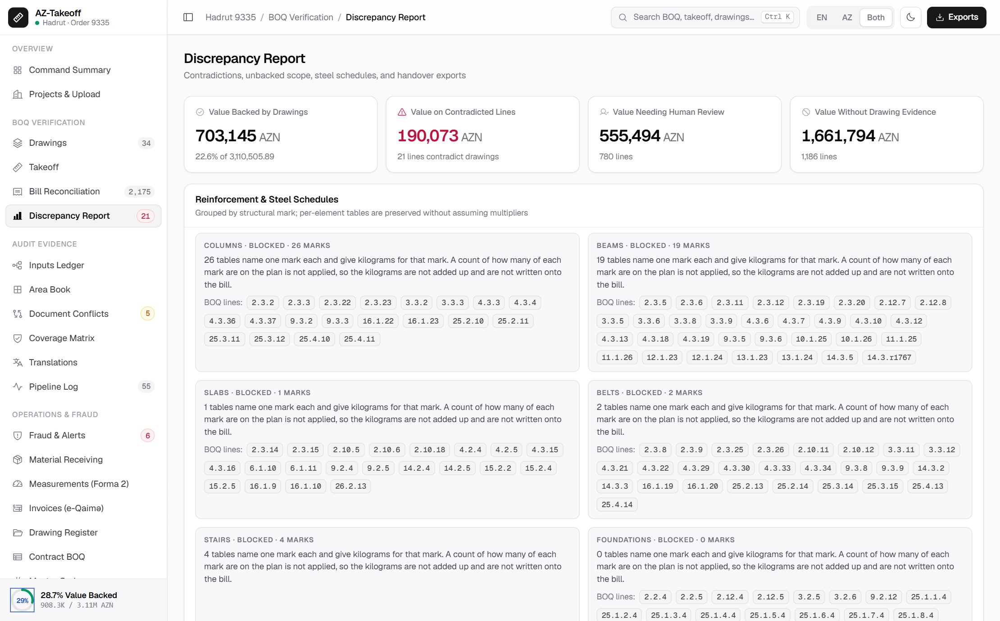

### Downloads

Exports lists eight files. Click the download icon on a row.

1. `BOQ-Hadrut-by-floor.xlsx` and the PDF. The bill split by floor.
2. `BOQ-Hadrut-checked.xlsx` and the PDF. The client bill with the check filled in. Quantities in the client file are not rewritten. The check is added.
3. `BOQ-Hadrut-generated.xlsx` and the PDF. A bill built from the measured items.
4. `Hadrut-discrepancy-report.xlsx` and the PDF. The differences, for handing over.

The date under Exports is when those files were written. If the list is empty, the export command has not been run.

Under the downloads, How faithful the filled bill is says whether the check changed the client's cell styles or the client's quantities. On a faithful run both stay at zero. The check is added beside the client's numbers. It does not replace them.

## 9. Inputs ledger

Open Inputs ledger. This is every number the check uses, in one table, with the first place it was read.

The chips group them by how they were obtained: Measured from geometry, Printed on a drawing, Read from a schedule, Calculated from other values, and Project rule. Search finds a value, an item name, or a note.

The columns are the name, the number, the status, how it was obtained, the first source file and sheet, and the note. The note is the plain explanation, for example that the depot long side is the largest repeated horizontal plan dimension and that 31 dimensions measure 45200.4, which is 45.2004 m.

Click a row to open that measured item on Takeoff, where the full formula and every source are shown. Use this page when you want to audit the ingredients, and use Takeoff when you want to see them on the sheet.

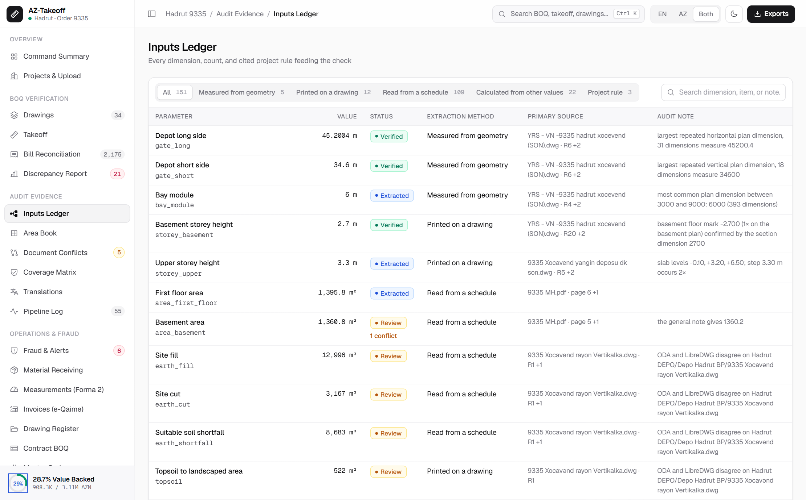

## 10. Area book

Open Area book.

Each floor is a table. The columns are the room number, the room name, the area from the room schedule, the hatch area where a room tag sits inside a hatch, and the bill lines that use that floor. A dash in the hatch column means no hatch was found for that room. Do not treat a hatch as the floor when the two columns disagree. On the basement the rooms sum to 1,371.8 square metres and the printed total is 1,360.80, so the gap is shown in the heading.

When documents disagree, a card lists every printed number and which file said it. Under the card the instruction is: choose a number already printed above. The line stays in review.

Type one of those printed numbers, your name, and why this side. Click Decide. A number that is not already printed is rejected. The original numbers stay on the card.

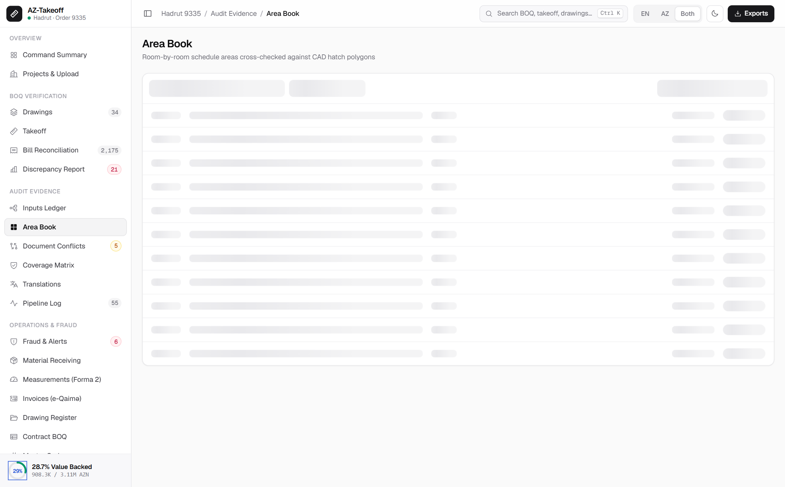

## 11. Conflicts

Open Conflicts. A conflict is two documents that do not say the same thing. Both sides are kept. Nothing is averaged and nothing is chosen for you.

Each card has a title, a status such as Not decided, and the two quantities in words. Open line jumps to the bill line. The sheet panel says On the sheet, and under that, Pick a drawing text on the left. Until you click a text, the picture is empty and says: Pick something with a source to see it on its sheet. The picture in this section shows that empty sheet. Click a text and the same panel shows that sheet with the words marked.

On this check the downpipes card says the stated length is 154.2 m and the itemised length is 190.5 m, and it opens line 2.5.14. The drawing conflict card keeps three printed areas for the same room, 658.30, 658.30, and 665.3, from different schedules. You decide by opening the line or the area book, not by editing the conflict card itself.

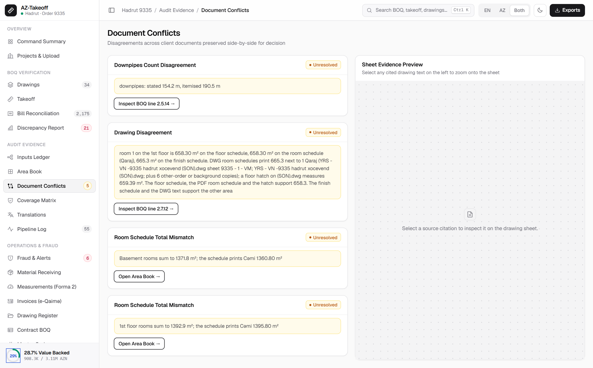

## 12. Coverage

Open Coverage.

The five cards say how the package covers the bill money. On this check, 96.0 percent of the value has a drawing. Green is a drawing file, blue is PDF only, orange is scan only, and red is nothing. 15 cells have nothing, worth 44,461.88.

The grid under that is bill value by building and trade. Each cell is the money of those bill lines, coloured by what the package holds. A dot means that building has no lines in that trade. Click a cell to open the bill for that building. Use this page when a trade looks empty and you need to see whether the package simply has no drawing for it.

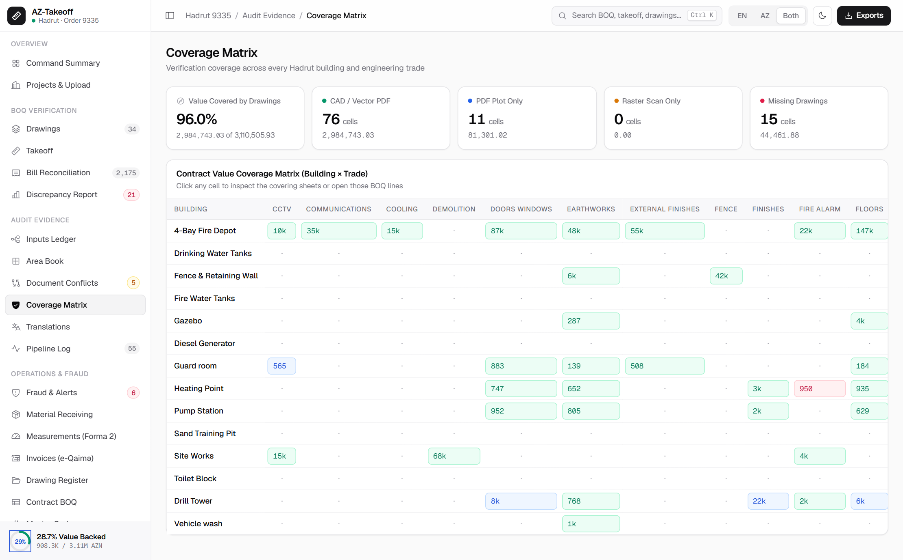

## 13. Translations

Open Translations.

The table has the Azerbaijani source, the English, and where the English came from.

Glossary means the phrase was translated from the fixed word list. Section titles such as 4 bay fire station building are in this group. Machine means the English was stored by the translation job and the numbers and codes in the sentence survived. Corrected means a person edited the English. Pending means there is no English yet, so the bill still shows Azerbaijani.

The chips count each kind. On this check there are 1,233 strings: 107 from the glossary, 1,100 from the machine, 0 corrected, and 0 pending. A few more are marked for a look because a code such as K1T contains a digit, or because a short word such as Ventilyator became Fan and the length check was unsure. Those still have English, and the Azerbaijani remains the source.

Search works in either language. Correct opens a box on that row. Change the English and save. The Azerbaijani source is not changed, and the check keeps using the Azerbaijani.

EN, AZ, and Both on the top bar use this table. They do not change any quantity.

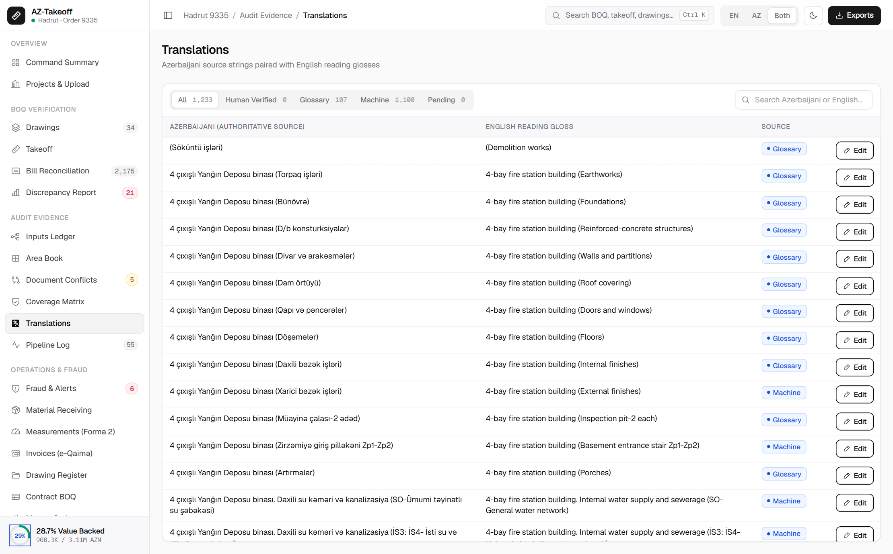

## 14. Run log

Open Run log.

Review items lists every warning. None is hidden. On this check there are 55. All and Warning filter them. The stage chips (bill, conversion, takeoff, match, and the others) show only the warnings from that stage.

Each row is one warning and the stage name. Examples you will see: a workbook row that is not a header or a line, an unknown unit, a DWG where the two readers disagree, and a DWG that only one reader opened. A reader disagreement is why values from that file stay in review.

Beside that list, Stage events is every step of the run, not only the warnings. DWG conversion and second reader puts the two readings side by side: the ODA count and the LibreDWG count. Click a file name there to open that drawing.

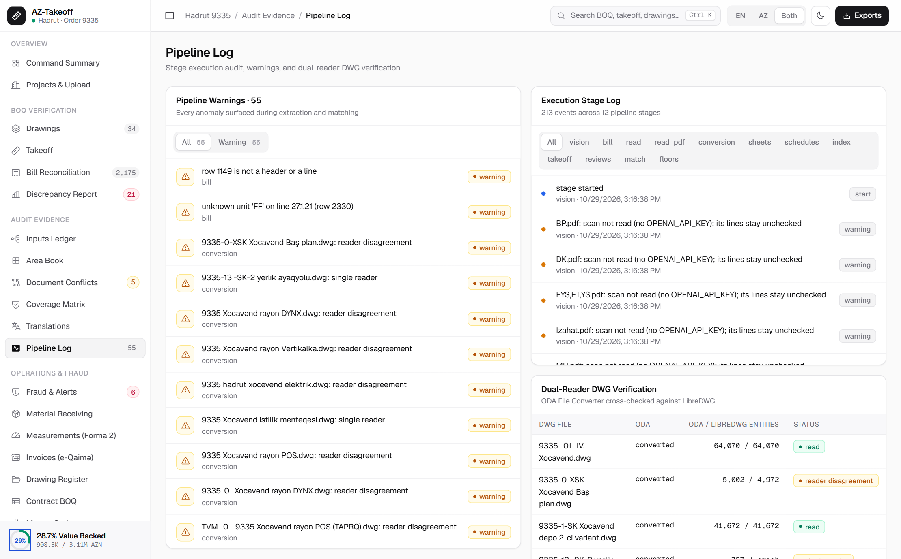

## 15. Operations & Fraud Intelligence

Open **Fraud & Alerts** or any departmental register under **Operations & Fraud**.

**Fraud & Alerts** continuously evaluates five cross-register control rules (`F1`–`F5`) across Material Receiving (`PJ_08`), Forma-2 Site Measurements (`PJ_12`), e-Qaimə Invoices (`PJ_13`), and the baseline Contract BOQ (`PJ_12`):
- **F1:** Cumulative material delivered exceeds contract BOQ limit.
- **F2:** Subcontractor e-Qaimə billed quantity exceeds certified Forma-2 progress.
- **F3:** Duplicate weighbridge / waybill ticket booked twice.
- **F4:** Invoiced unit rate exceeds contract BOQ rate without an approved Variation Order.
- **F5:** Material consumption exceeds certified installation plus norm waste allowance.

Each alert displays a two-sided comparison strip, financial exposure in AZN, and persistent actions (**Enforce Payment Hold** or **Log Exception**) saved to SQLite with the auditor's name, justification, and timestamp.

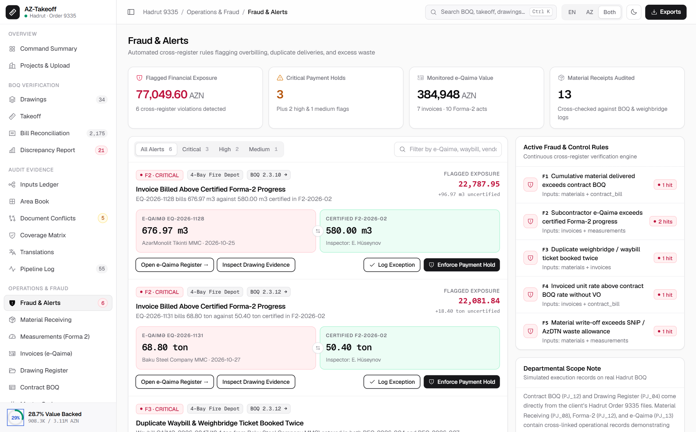

**Material Receiving**, **Measurements (Forma 2)**, and **Invoices (e-Qaimə)** display simulated site execution records linked to real Hadrut BOQ line codes (badged as `Simulated Site Execution Data`), alongside the client-extracted **Drawing Register**, **Contract BOQ**, and **Master Codes**.

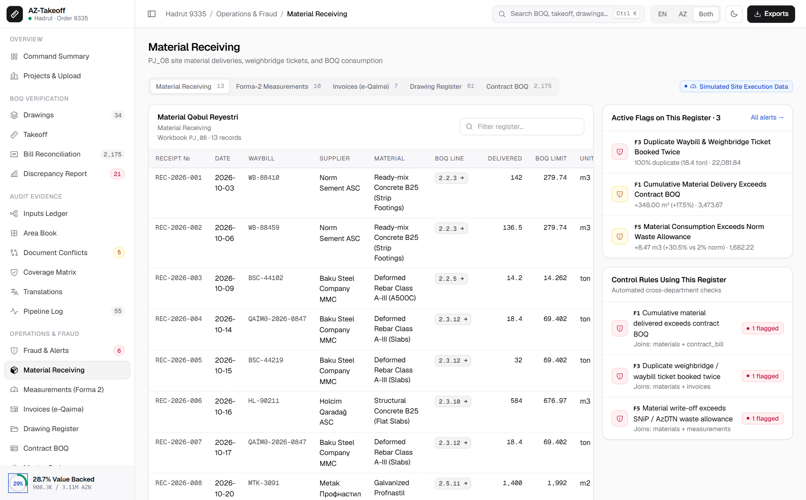

## 16. A short way to check one figure

1. Find the line. Use search, or open Bill and filter Different, Needs review, or Not on drawings.
2. Read Bill says and Drawings say.
3. Read the reason.
4. Click Where it is printed and look at the words on the sheet. If the words are about a different thing, the number is not evidence for this line.
5. If the line follows a measured item, open it from How it is calculated, or find the item on Takeoff. Read the rule, the formula, and each input. Click each input until you have seen the cell or the dimension on the drawing.
6. If you still need a different quantity, use Set the quantity, with your name and a reason. If you were wrong, use Use the measured figure.

The program will not invent a missing dimension, will not average two disagreeing documents, and will not treat a scan as a measurement.
